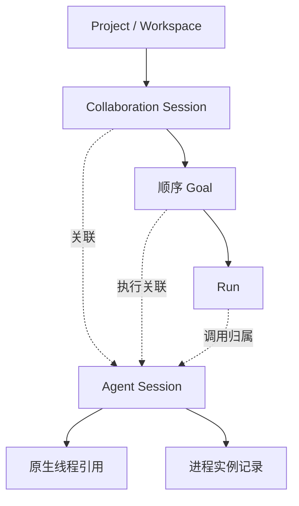
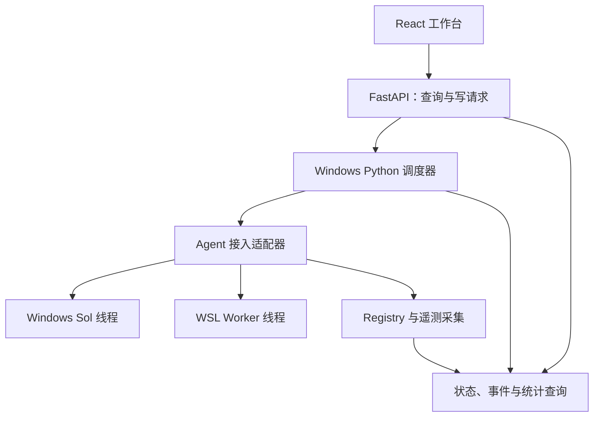

# agentProj V2.2：完整设计过程与实现规格

> 文档用途：保存本轮前端与多 Agent 工作台讨论的需求演进、设计理由、方案取舍、当前规格、待核实事项和开发验收要求，作为后续交给 Codex 的设计上下文。
>
> 设计版本：V2.2；整理版本：1.0。
>
> 讨论日期：2026-10-15（America/Los_Angeles）；文件整理时 UTC 日期为 2026-10-16。
>
> 文档性质：设计讨论整理与建议规格，不是源码审计报告、已实现功能清单或真实运行验收报告。

## 目录

1. 文档依据、完整性边界与结论等级
2. 项目目标与使用场景
3. 从 V2 到 V2.2 的设计演进
4. 用户新增需求的逐项评估
5. 设计决策记录与架构原则
6. 领域对象、关联关系与统计归属
7. 信息架构、导航与路由
8. 主工作区与五种关键页面状态
9. 合并消息流、接收者选择与投递协议
10. 多 Goal 生命周期、恢复与后端状态真相
11. 三级 Dashboard 与原生会话详情
12. WSL Codex CLI 模型配置
13. Agent Session Registry 与接入策略
14. 上下文与用量监控
15. 调用失败采集与统一审计
16. 四类 Skill 与分析报告
17. 树状 Wiki 与项目文件浏览器
18. 后端模块与建议接口契约
19. 协作事件、SSE、幂等与刷新恢复
20. 数据质量、证据与审计规则
21. 前后两版开发计划及统一实施路线
22. 验收矩阵
23. 待核实问题、延期范围与主要风险
24. 给 Codex 的实施交接要求
25. 需求追踪矩阵与用户原始补充

---

## 01. 文档依据、完整性边界与结论等级

### 1.1 本次整理覆盖什么

本文件依据当前对话中可见的 agentProj V2.1 设计内容、用户随后提出的补充要求，以及围绕补充要求形成的 V2.2 方案整理。

覆盖内容包括：多 Goal 协作会话、三级 Dashboard、Windows Sol / WSL Worker 原生会话管理、模型配置、指定会话消息投递、上下文和用量监控、调用失败记录、四类 Skill、树状 Wiki、前后端契约、事件恢复、实施阶段和验收要求。

“完整设计过程文件化”在本文件中指：对可见讨论的需求、推导、选择、限制和后续工作完整归档，而不是只摘录最终结论。整理时补充的工程建议会明确标注，不冒充用户原话或已审计事实。

### 1.2 当前材料的边界

- 提供的外部会话内容存在前文省略，V2.1 可见片段从接口列表中段开始。本文件不声称恢复了省略部分的逐字原文。
- 未读取用户本机 `ui`、`backend`、FastAPI 模型、Python 调度器或 Codex 配置。
- 未在用户 Windows / WSL 环境验证原生线程发现、消息注入、上下文遥测、模型切换、恢复和并发控制。
- 原讨论提到过交互原型，但本轮材料没有完整原型源码或截图可供逐项复核；本文件记录设计意图，不宣称已有可运行 React 工程。
- 原讨论引用的 Codex 官方能力属于技术选型线索。本次任务是整理设计，没有重新验证这些能力在当前版本中的确切支持范围；应在 P0 审计时核实。

### 1.3 结论等级

| 标记 | 含义 | 使用方式 |
| --- | --- | --- |
| 用户明确要求 | 用户直接提出或明确认可的需求 | 作为产品需求记录 |
| 原讨论建议 | 已在可见讨论中提出的设计方案 | 可作为实现候选，不等于用户逐条批准 |
| 本次整理补充 | 为消除歧义而补充的工程细化 | 实现前与既有代码核对 |
| 待 P0 核实 | 依赖源码、协议、版本或运行环境的能力 | 不在界面中提前承诺 |
| 后续阶段 | 明确延后或需先满足前提的能力 | 不混入首期已完成范围 |

“建议冻结”表示方案已具备作为开发基线的条件，不能理解为所有接口、字段、阈值和技术选型已经最终定案。

## 02. 项目目标与使用场景

### 2.1 产品定位

agentProj 是围绕 Windows Sol 与 WSL Codex Worker 协作的 AI 开发工作台。用户在一个项目中建立协作会话，与 Sol 持续讨论，按顺序推进多个 Goal，并通过统一界面查看 Worker 执行、测试证据、验收、用量和故障。

V2.2 相比单纯管理 Goal / Run 的页面，增加了对真实 Agent 原生线程、配置、上下文和调用可靠性的管理。

### 2.2 主要角色

| 角色 | 工作职责 | 在工作台中的表现 |
| --- | --- | --- |
| 用户 | 提需求、讨论、调整约束、选择消息目标、处理必要审批 | 主对话、Goal、配置、分析入口 |
| Windows Sol | 规划、讨论、验收与重规划 | 合并消息流中的 Sol 身份及关联原生线程 |
| WSL Worker | 执行实现、命令、测试等受分配工作 | 可有多个具名 Worker 及各自原生线程 |
| Windows Python 调度器 | 状态转移、授权、预算、消息投递、执行与恢复控制 | 后端执行控制中心 |
| React 前端 | 展示、输入、导航、筛选与交互 | 使用后端提供的状态和可用操作 |

Sol / Worker 是角色；Windows / WSL 是运行环境；模型提供方与模型 ID 是配置。这三个维度不能绑定为同一个字段。Worker 不应在领域模型中被固定写死为某一个模型品牌。

### 2.3 典型日常流程

1. 创建或进入项目，选择协作会话。
2. 默认与 Windows Sol 讨论需求，形成当前 Goal 与验收条件。
3. 调度器按权限、预算、状态和能力决定是否启动 Worker。
4. Sol 与 Worker 的相关消息、执行摘要和结果进入统一时间流。
5. 用户可选择向某个具名 Worker 发送消息；投递仍由调度器控制。
6. Worker 返回结果后，Sol / Goal Review 对照条件验收。
7. 未通过时保留失败、证据与重规划记录；通过后结束当前 Goal。
8. 在同一协作会话内继续下一 Goal，保留连续讨论历史。

后续 Goal 不应因为前一 Goal 完成或网页刷新而未经合法启动流程自动执行。

## 03. 从 V2 到 V2.2 的设计演进

### 3.1 演进总览

| 阶段 | 当时关注点 | 形成的方案 | 后续变化 |
| --- | --- | --- | --- |
| V2 基础方向 | 让规划与执行在同一工作区可理解、可追踪 | Sol / Worker 合并时间流、Goal 摘要、固定输入区、详情抽屉 | 保留为主界面基础 |
| V2.1 结构化 | 明确协作对象、执行边界和前后端职责 | 一个协作会话关联多个顺序 Goal；执行真相归后端；事件排序、恢复、幂等 | 保留为架构基础 |
| 用户补充 | 从单个 Goal 页面扩展为多 Agent 工作台 | 三级 Dashboard、模型配置、指定会话消息、全对话上下文监测、失败记录、树状 Wiki | 直接推动 V2.2 范围扩大 |
| V2.2 方案 | 把真实原生会话与可信遥测纳入设计 | Registry、Context / Usage / Failure 契约、配置版本与能力检测 | 先审计能力，再接真实数据 |

该过程不是推翻前一版。V2.2 保留 V2.1 的界面和控制原则，补齐多 Agent 管理及监控数据层。

### 3.2 V2.1 已提出的核心结构

- 页面采用全局导航、项目会话侧栏、合并对话流、固定输入区、按需详情抽屉。
- 对象关系采用 Project / Workspace → Collaboration Session → 多个顺序 Goal → Run。
- Windows Sol / WSL Worker 的原生会话是关联资源，不作为前端一级导航。
- 用户默认发给 Sol；允许经过调度器向 Worker 直接发消息。
- 前端负责展示和交互；FastAPI / Python 调度器负责执行真相、授权、预算、状态与恢复。
- 页面刷新、SSE 重连只恢复界面，不触发新的 Run。
- 原型优先覆盖日常执行、首次进入、完成、预算暂停、环境阻塞五种状态。

### 3.3 V2.1 中 Dashboard 范围的原始建议

原讨论曾建议：工作区右侧 Dashboard 默认显示当前协作会话，并允许切换 Goal、Run 和整个项目。

这一建议解决了抽屉内的统计范围，但还没有充分表达“全局导航总览”和“项目总览”的独立职责。

### 3.4 用户补充带来的修订

用户明确了三级统计关系：

- 一级导航 Dashboard：看所有项目。
- 项目 Dashboard：看该项目中的会话。
- 协作会话 Dashboard：看 Goal、Windows Sol 及子 WSL Codex 会话的数据。

因此 V2.2 将三级 Dashboard 正式区分，并增加可下钻的“原生 Agent 会话详情”。原生会话详情是明细页或抽屉，不增加一个同级全局导航层。

### 3.5 从“角色消息”到“具体线程消息”的变化

早期输入区可以只表达“发送给 Sol / Worker”。用户提出选择某个 WSL Codex CLI 后，接收目标必须变成可寻址的具体原生会话。

这引出三项后端需求：

1. 原生会话注册表，记录内部 ID 与 Codex 原生线程 ID。
2. 会话能力检测，区分可读取、可发送、可恢复、可中断。
3. 消息投递状态机，区分排队、已受理、实际投递、回复和未知结果。

### 3.6 从“Token 统计”到“可信监控”的变化

用户希望监测所有对话上下文和调用失败，因此设计不能只有累计 Token 图表。

V2.2 拆分为：累计用量、当前上下文压力、上下文演变、调用可靠性。四者共享事件关联，但含义、更新频率和统计口径不同。

### 3.7 从“前端重设计”到“前后端共同改造”的变化

在 V2.1 中，可以先独立完成 React Mock 前端。V2.2 新增的线程寻址、配置应用、遥测、失败归因和跨 Goal 去重，直接依赖后端数据层和 Agent 接入协议。

因此先做独立前端仍合理，但 Registry 与监控契约需要尽早定义，不能完全留到界面完成以后。

## 04. 用户新增需求的逐项评估

| ID | 用户需求 | 原讨论结论 | 采纳后的具体含义与限制 |
| --- | --- | --- | --- |
| R01 | 一个协作会话连续处理多个 Goal | 完全采用，且用户明确认可 | 历史连续，Goal 的计划、Run、预算和验收独立归属 |
| R02 | 一级导航 Dashboard 看各项目 | 完全采用 | 全局聚合与项目比较，可下钻至项目 |
| R03 | 项目 Dashboard 看会话 | 完全采用 | 以协作会话为主表，补充 Goal、预算及冲突信息 |
| R04 | 会话 Dashboard 看 Goal 和 Sol / Worker 窗口用量 | 完全采用 | 提供 Goal、角色、原生线程、Run 等维度；窗口映射为结构化会话 |
| R05 | 设置 WSL Codex CLI 模型配置 | 完全采用 | 配置模板、继承、会话覆盖、版本及实际生效配置 |
| R06 | 底部选择 Windows Sol 或某个 WSL Codex CLI | 完全采用 | 只能向已注册且具备发送能力的具体会话投递 |
| R07 | 监测所有对话上下文 | 有条件采用 | 覆盖注册会话；区分实测、估算、不可用和过期，不承诺不可观察会话的精确容量 |
| R08 | 记录调用失败 | 有条件采用 | 对受控调用建立完整记录；外部调用记录可观察事实，不推断不存在的错误码 |
| R09 | Wiki 树状索引 | 完全采用 | 受管理文档树、Markdown、引用、检索及版本追踪 |
| R10 | 任意现有 Codex 窗口都可直接控制 | 不作为当前承诺 | 先验证线程发现和接管；日志可读不等于线程可控制 |
| R11 | 多个 Worker 同时修改一个 Goal | 作为后续能力 | 多会话可存在，代码写入初期串行；并发需要隔离和资源锁 |

R10、R11 是原讨论针对需求边界提出的限制，不应误记为用户已经要求或已拒绝的独立功能。

## 05. 设计决策记录与架构原则

### 5.1 决策记录

| 决策 | 选择 | 选择理由 | 未选择的做法及原因 | 状态 |
| --- | --- | --- | --- | --- |
| D01 | 协作会话支持多个顺序 Goal | 保留连续讨论，避免每个目标割裂历史 | 一会话只容纳一个 Goal，不满足用户明确选择 | 用户明确认可 |
| D02 | Sol / Worker 合并时间流 | 便于看清规划、执行、验收、重规划的关联 | 只按角色分开聊天，会削弱协作过程可读性 | 原讨论基线 |
| D03 | 全局、项目、会话三级 Dashboard | 与用户工作范围一致，支持逐级下钻 | 单一范围可变的 Dashboard 不足以表达导航职责 | 用户明确要求 |
| D04 | 原生线程与进程实例分离 | 线程可被恢复，进程不等于聊天窗口 | 将一个 PID 永久视为一个线程，无法正确恢复和统计 | 原讨论建议 |
| D05 | Windows Python 调度器保持唯一执行控制中心 | 复用既有权限、预算、幂等和恢复规则 | 前端或 Router 自建调度中心，会产生相互冲突的执行判断 | 原讨论原则 |
| D06 | 向具体已注册会话投递 | 用户可明确选择 Worker，后端可验证目标 | 向模糊角色广播或写入任意终端，缺少可靠寻址 | 用户需求的实现方案 |
| D07 | 模型配置由模板、Profile 或受控参数应用 | 限定影响范围，保留现有手动使用习惯 | 前端直接覆盖整个 Codex 用户配置文件，影响范围不可控 | 原讨论建议 |
| D08 | 请求配置与实际配置分开 | 模型变化需可审计，不能误报正在运行的模型 | 保存配置后立即把运行中模型标签替换，会失真 | 原讨论建议 |
| D09 | Usage、Context、Failure 分立且共享关联键 | 三类指标定义不同，需分别采集与解释 | 用累计 Token 表示当前上下文，会造成错误预警 | 原讨论原则 |
| D10 | 每个监控指标记录来源、质量、时间 | 保证未知、估算和实测可分辨 | 缺失记零、模拟充当实测，会污染预算和复盘 | 原讨论原则 |
| D11 | Wiki 树与代码目录树分开 | 文档知识组织与源码浏览目的不同 | 自动镜像整个代码目录，会导入依赖、缓存和大量噪声 | 原讨论建议 |
| D12 | 保留已有 exec 链，评估 app-server | 兼顾已有执行链与长期交互需求 | 因前端重构立即替换全部执行协议，风险与范围过大 | 待 P0 核实 |
| D13 | 首期同一 Goal 的代码写入串行 | 使变更和证据能够准确归属 | 共享目录多 Worker 任意并发，容易产生冲突 | 原讨论建议 |
| D14 | Skill 做分析，普通程序做日常计量和门控 | 确保确定性统计，不因监控增加持续模型调用 | 用 Skill 实时计数、阻止启动，职责与执行规则混乱 | 原讨论原则 |
| D15 | 保留旧 UI，独立预览后渐进接入 | 降低迁移对现有工作流的影响 | 未完成契约与回归就删除旧 UI，难以稳定验收 | 原讨论建议 |

### 5.2 必须贯穿全系统的原则

1. 前端不自行推断 Goal 已完成、Run 已停止或预算允许执行。
2. 浏览器显示的 `allowed_actions` 只是当前快照；每次写操作由后端重新校验。
3. Worker 声称完成不等于 Goal 验收通过。
4. 预算上调不自动恢复；恢复仍检查状态、权限和执行前提。
5. 原进程或消息受理状态未知时，先核查，不盲目重启或重发。
6. 历史导入、模拟数据、估算与真实执行证据保持可辨识。
7. 所有受控执行、消息和用量应能追溯到线程、Goal、Run 或明确的未归属范围。
8. 简洁浅色 IDE 风格、中文优先、密度适中；状态依靠文字和颜色共同表达。

## 06. 领域对象、关联关系与统计归属

### 6.1 术语表

| 对象 | 定义 | 容易混淆的对象 |
| --- | --- | --- |
| Project / Workspace | 项目资源与工作目录范围；两个名称是否等价由现有模型决定 | 不能因新 UI 再造重复项目对象 |
| Collaboration Session | 用户持续讨论和推进多个 Goal 的协作容器 | 不是 Codex 原生线程 |
| Goal | 有目标、约束、计划与验收条件的工作单元 | 不是一次模型调用 |
| Run | Goal 的一次实际执行尝试或执行周期 | 不等于 Goal 本身或原生线程 |
| Agent Session | agentProj 注册的逻辑 Agent 会话 | 不等于进程 PID |
| Native Thread | Codex 等 Agent 运行时的原生对话线程 | 不等于网页协作会话 |
| Process Instance | 一次进程启动及其连接状态 | 同一线程可跨进程恢复 |
| Turn | 原生线程中的一次交互轮次 | 不等于整个 Run |
| Tool Call | 某轮 Agent 产生的一次工具调用 | 非零退出码不总等于整项任务失败 |
| Usage Event | 可去重、可归属的一条用量事实或增量 | 不是多次重复采集的累计快照 |
| Context Observation | 某时刻可观测的上下文状态 | 不是生命周期累计 Token |
| Failure Event | 可观察的一次故障、拒绝或检查失败记录 | 需按类别解释，不混为 Agent 失败 |
| Evidence | 命令、测试、日志、产物等可引用证据 | 导入对话不是执行证明 |
| Skill Invocation | 有输入、执行记录与输出的一次 Skill 调用 | 只启用 Skill 不等于已执行 |

### 6.2 核心层级



此图表达对象关系，不表示数据库已经按该结构实现。Agent Session 是关联资源，不能简单作为某个 Goal 的专属子记录。

### 6.3 多 Goal 与原生线程的关联

- 一个协作会话允许顺序处理 G01、G02、G03。
- 同一个 Sol 或 Worker 原生线程可能跨多个 Goal 存续。
- 一个 Goal 可能涉及多个 Agent Session 与多个 Run。
- 原生线程恢复后，保留线程身份，并记录新的进程实例或连接实例。
- 切换当前展示的 Goal 不应改变线程真正绑定的执行对象。

本次整理补充：线程与 Goal 的关联建议保留生效时间或事件区间，而不是只保留一个会被覆盖的 `active_goal_id`。这样才能解释同一线程此前为 G01、此后为 G02 产生的调用。

### 6.4 统计归属规则

每条原子用量或调用事件应尽可能具有：

`workspace_id / collaboration_session_id / goal_id / run_id / agent_session_id / native_thread_id / turn_id`

允许部分归属未知。例如用户先与 Sol 讨论、尚未建立 Goal 时，调用可归属于协作会话，不强制编造 Goal 或 Run。

同一条事件只入账一次，再按不同维度查询；不要分别给全局、项目、会话复制三份可再次求和的事实记录。

## 07. 信息架构、导航与路由

### 7.1 一级导航

| 导航 | 默认范围 | 主要用途 |
| --- | --- | --- |
| 全局 Dashboard | 所有项目 | 项目汇总、总用量、预算及异常 |
| 项目工作台 | 当前或待选择项目 | 进入项目、协作会话与执行工作区 |
| Wiki | 项目文档或跨项目检索 | 树状知识组织与查阅 |
| 会话监控与审计 | 可观察的注册会话 | 上下文、连接、失败及审计 |
| Skills | 可用 Skill 与调用记录 | 配置、触发分析、查看报告 |
| 环境与 Agent 配置 | 环境及配置模板 | Windows / WSL、模型、连接与能力 |

“Wiki”在全局导航中的入口可提供项目选择或跨项目搜索；文档的归属和权限仍在项目范围内。

### 7.2 项目内导航

- 顶部：项目名称、项目 Dashboard、当前协作会话状态。
- 左栏：协作会话列表、最近活动与状态筛选。
- 中央：Sol / Worker 合并消息流。
- Goal 区：当前 Goal、Run、阶段、验收与允许操作摘要。
- 底部：具体接收会话选择、草稿、发送与投递状态。
- 右侧详情：会话 Dashboard、上下文、时间线、证据、恢复、Wiki 引用。

Dashboard 与上下文监控可以互跳，但不合并成一个概念不清的页面：前者回答历史消耗与整体进展，后者回答当前线程压力和可靠性。

### 7.3 路由建议

以下为原讨论路由加 V2.2 补充，实际命名须匹配现有前端和后端对象。

```text
/dashboard
/projects
/projects/:workspaceId
/projects/:workspaceId/dashboard
/projects/:workspaceId/sessions/:sessionId
/projects/:workspaceId/sessions/:sessionId?goal=:goalId
/projects/:workspaceId/sessions/:sessionId?panel=timeline
/projects/:workspaceId/sessions/:sessionId?panel=dashboard
/projects/:workspaceId/sessions/:sessionId/reports
/projects/:workspaceId/wiki
/agent-sessions/:agentSessionId
/skills
/audit
/settings/environment
/settings/agents
```

应能通过 URL 直接定位 Goal、Run、事件和报告。具体是路径参数还是查询参数由前端路由统一，不重复创建同义页面。

### 7.4 页面状态保存

| 可以恢复的视图状态 | 必须向后端重新读取的执行状态 |
| --- | --- |
| 当前项目、协作会话、正在查看的 Goal | Goal / Run 当前状态与资源版本 |
| 各会话未发送草稿 | 预算剩余和是否允许执行 |
| 阅读位置、展开卡片 | Agent 连接和实际能力 |
| 非敏感筛选条件、选中详情面板 | Worker 队列、授权、投递结果 |

本次整理补充：草稿可以保留最近接收者选择，但恢复页面后需重新确认该接收者仍存在且可发送；不能把失效目标静默替换成另一 Worker。

## 08. 主工作区与五种关键页面状态

### 8.1 视觉和交互基线

- 采用浅色 IDE 风格，弱装饰，主要依靠排版、分隔和状态标签组织信息。
- 中文优先，专有名词和 ID 可保留英文。
- 保持主对话流可读；日志、证据和完整执行输出按需展开。
- 重要状态同时有文本与颜色，不能只靠红绿区分。
- 状态标签应说明范围，例如“Run 运行中”“Goal 待验收”，避免只写含糊的“进行中”。

### 8.2 主区域规格

| 区域 | 展示内容 | 交互要求 |
| --- | --- | --- |
| 协作会话列表 | 名称、当前 Goal、最近活动、状态 | 切换后草稿与阅读位置独立保存 |
| Goal 摘要 | 目标、计划版本、Run、阶段、验收 | 详情可展开，操作依赖后端允许动作 |
| 合并消息流 | 用户、Sol、Worker、调度事件 | 区分来源，可跳转因果引用与证据 |
| 执行卡片 | 执行摘要、进度、结果、测试和错误 | 展开细节，避免全部日志撑满主流 |
| 输入区 | 接收者、文本、发送状态 | 显示排队、拒绝及发送限制原因 |
| 详情抽屉 | 用量、上下文、证据、恢复、时间线 | 与主流双向定位，保留当前阅读位置 |

### 8.3 五种必须具备的 Mock 状态

| 状态 | 页面必须表达 | 关键交互 | 不应产生的行为 |
| --- | --- | --- | --- |
| 首次进入 | 项目 / 会话为空或尚未创建 Goal | 创建项目、会话、开始讨论 | 创建页面即隐式执行 |
| 日常执行 | 当前 Goal、正在运行的 Run、消息和阶段 | 查看日志、按许可暂停、投递消息 | 前端自行判定执行成功 |
| 完成 | Worker 结果与 Goal 验收结论分开 | 查看证据、创建下一 Goal | Worker 完成即把 Goal 标成通过 |
| 预算暂停 | 预算范围、触发原因、后续允许动作 | 调整预算、查看消耗、合法恢复 | 提高预算即自动启动 |
| 环境阻塞 | WSL、认证、进程、连接等阻塞及检查时间 | 继续 Sol 讨论、检查环境、查看恢复前提 | 状态未知时自动重启 Worker |

完成状态建议同时覆盖“Worker 已完成、Goal 待验收”和“Goal 验收通过”两个变体，防止界面把它们混为一态。

### 8.4 长历史与可用性

原讨论要求长历史性能验收。本次整理补充的实现候选：消息分页或虚拟列表、执行卡片懒加载、历史查询与实时订阅分离。具体方案需结合现有组件和数据量决定，不预先规定一个未经测试的性能数字。

## 09. 合并消息流、接收者选择与投递协议

### 9.1 合并流的目的

主流应看得出：用户提出什么 → Sol 如何规划 → 哪个 Worker 执行 → 返回哪些结果 → Sol 如何判断 → 是否重规划。

不能只把两个原生聊天记录按时间戳拼接。需要稳定的协作序号、原始消息身份和因果引用。

### 9.2 消息类型

| 类型 | 例子 | 必要区别 |
| --- | --- | --- |
| 用户讨论 | 给 Sol 的需求、补充与确认 | 接收者明确，允许尚未归属 Goal |
| 用户给 Worker 的消息 | 补充执行要求、询问进度 | 经过调度器，显示实际投递状态 |
| Sol 消息 | 计划、判断、验收、重规划 | 引用相关 Goal / Run / 证据 |
| Worker 消息 | 执行摘要、过程反馈、完成报告 | 标识具体 Worker 和线程 |
| 系统事件 | 排队、暂停、预算拒绝、连接变化 | 与模型自然语言消息区分 |
| 导入记录 | 外部历史对话、参考材料 | 展示来源，不形成执行或计费事实 |

### 9.3 底部接收者选择

默认选择 Windows Sol。弹出列表展示可关联的具体会话，例如 Windows Sol、WSL Worker 01、WSL Worker 02，并展示角色、环境、连接状态、当前工作及可发送能力。

不可发送的会话可以显示为禁用项并说明原因，也可以在只读详情中查看；不能让“已注册”自动等于“可投递”。

发送时提交稳定的 `agent_session_id`，后端解析到原生线程和适配器。不要将窗口标题、列表顺序或 PID 当作唯一寻址依据。

### 9.4 Worker 运行中消息策略

原讨论认可“经调度器授权直接发送”，并提出 `queue_next_safe_point`。正式实现应根据能力和策略选择：

- 排队，在下一安全执行点投递。
- 当前状态不允许，拒绝并解释原因。
- 适配器确实支持且调度器允许时，使用经验证的轮内引导能力。

不得因选择 Worker 而绕过预算或代码写入锁；用户发送执行要求与普通询问能否分别处理，应在 P0 / P2 明确。

### 9.5 建议消息投递状态

本次整理补充以下候选状态，实际枚举由现有模型统一：

| 状态 | 含义 |
| --- | --- |
| draft | 仅在输入框中，未提交 |
| submitting | 正在提交给后端 |
| accepted | 调度器已受理，不代表线程已收到 |
| queued | 等待安全执行点 |
| delivered | 已获得适配器可验证的投递确认 |
| responded | 已出现关联回复 |
| rejected | 授权、状态、预算或能力检查拒绝 |
| failed | 已确认投递失败 |
| unknown | 请求超时或失联，无法确认是否受理 |

`responded` 不是“Goal 验收通过”。状态为 `unknown` 时先查询原请求，不换新幂等键重发。

### 9.6 切换接收者与草稿

本次整理补充：用户切换接收者时应保持正文，不自动发送；明显展示当前目标。提交后，消息记录保留提交时的目标，后续切换下拉框不改变已排队消息的归属。

## 10. 多 Goal 生命周期、恢复与后端状态真相

### 10.1 顺序 Goal

用户明确选择“一个协作会话连续执行多个 Goal”。因此讨论历史可以连续，Goal 的计划、预算、Run 和验收记录独立。

建议首期一个协作会话只激活一个执行 Goal，其余目标可作为草案或后续队列；这属于本次整理的明确化建议，需和现有调度规则核对，不能直接假定后端已有此约束。

### 10.2 状态维度分开

| 维度 | 说明 |
| --- | --- |
| Goal lifecycle | Goal 的业务生命周期 |
| Run status | 某次执行是否运行、结束或未知 |
| Run phase | 当前是在实现、测试等哪个阶段 |
| dispatch gate | 下一轮是否允许派发以及拦截原因 |
| review status | 验收是否待处理、通过或未通过 |
| connection / capability | 原生线程是否可查询、发送、恢复等 |

避免造一个包含所有组合的巨型状态枚举。上述维度的实际值仍应复用现有模型。

### 10.3 Goal 工作区摘要示例

以下保留原讨论的建议结构；它不是对已存在 API 的确认。

```json
{
  "goal_id": "goal_02",
  "collaboration_session_id": "session_01",
  "revision": 18,
  "lifecycle": "in_progress",
  "run": {
    "id": "run_02",
    "status": "running",
    "phase": "testing"
  },
  "dispatch_gate": {
    "status": "allowed",
    "reason": null
  },
  "review": {
    "status": "pending"
  },
  "allowed_actions": [
    {"action": "pause", "enabled": true},
    {"action": "resume", "enabled": false, "reason": "任务未处于可恢复状态"},
    {"action": "send_to_worker", "enabled": true, "dispatch_mode": "queue_next_safe_point"}
  ]
}
```

前端展示禁用原因；后端在真正执行时重新检查权限、状态、资源版本、预算和目标能力。

### 10.4 恢复必须具备的上下文

- 为什么停止或暂停。
- 原进程是否仍在，是否存在未确认的请求。
- 当前有效 Goal / Run / 配置版本。
- 恢复的前提及合法操作。
- 最后成功步骤和可引用证据。
- 恢复是否延续原 Run 或创建新 Run，由后端规则决定。

增加预算、刷新页面、恢复 SSE、重连 WSL 都不是自动恢复执行的充分条件。

## 11. 三级 Dashboard 与原生会话详情

### 11.1 统计层级

| 层级 | 默认统计对象 | 主要回答的问题 | 下钻目标 |
| --- | --- | --- | --- |
| 全局 Dashboard | 项目 | 哪些项目活跃、消耗多少、哪里超预算或异常 | 项目 Dashboard |
| 项目 Dashboard | 协作会话 | 各会话推进如何、消耗多少、是否共享资源造成冲突 | 会话 Dashboard |
| 协作会话 Dashboard | Goal 与 Sol / Worker | 各 Goal 和 Agent 的资源花在哪里，失败及重规划如何 | Goal、Run、原生会话、事件 |
| 原生 Agent 会话详情 | 某个具体线程 | 模型、当前上下文、累计用量、连接和失败情况 | Turn、调用、故障、证据 |

第四行是明细层，不是新增的第四个一级 Dashboard。

### 11.2 全局 Dashboard

建议展示：项目数、活跃项目、运行 / 暂停 / 异常状态、各项目 Token、预算接近程度、活跃 Sol / Worker 数、调用故障和上下文风险摘要。

以项目比较为主，不默认铺开大量原生日志。任何“总量”都应显示统计时间范围、数据更新时间和覆盖质量。

### 11.3 项目 Dashboard

以协作会话为主表，展示：会话活动状态、Goal 完成数量、Sol / Worker 使用情况、Token、预算、异常次数和最近进展。

还应能查看是否共享 Worker、工作目录或 Git 分支。共享本身不等于冲突，需要结合当前写入活动与锁状态判断。

本次整理补充：Goal 完成率应明确分母，例如统计窗口内已进入执行的 Goal 是否包含取消、未验收和仍在进行的 Goal。不能用未定义的百分比比较会话效率。

### 11.4 协作会话 Dashboard

建议提供下列视角：

- 按 Goal：各目标的 Run 数、用量、用时、重试、验收和重规划。
- 按 Agent：Windows Sol 与各具名 Worker 的调用、用量、错误。
- 按原生线程：跨 Goal 持续存在的线程及其分段消耗。
- 按 Run：执行阶段、命令、测试、失败和结果。

趋势图允许按时间、执行轮次、Agent 切换。点击异常增长的 Run，可以定位到消息、测试记录和重试，而不是只弹出一个数值。

### 11.5 统一统计口径

| 指标 | 必须明确的口径 |
| --- | --- |
| Token 总量 | 唯一事件、归属、增量方式与去重，跨 Goal 复用线程不重复入账 |
| 输入 / 输出 | 区分输入和输出；按实际协议记录 |
| 缓存 / 推理明细 | 确认是否已包含在输入 / 输出中，不把子项再次加到总量 |
| 预算 | 区分硬预算、预警值、未设置；明确单位和作用范围 |
| Agent 用量 | 分 Sol、Worker 和具体 Agent Session |
| 模型用量 | 按实际调用模型、提供方、推理配置与配置版本 |
| 成本 | 有可靠价格依据才估算，记录货币、价格版本和计价方法 |
| 实时性 | 最后采集时间、聚合时间、可能延迟 |
| 数据质量 | 实测、估算、模拟、未知分别展示 |
| 故障数量 | 按类型、尝试、是否恢复统计，避免把一次故障的重连事件重复计数 |
| Token Audit | 主动触发，保留报告、范围与依据 |

累计用量可以作为会话展示值，但不能将线程累计快照全额计入每个 Goal。

### 11.6 去重与跨 Goal 示例

示例仅说明统计方法，不是真实运行数据：

| 用量事实 | 线程 | Goal | 增量 Token |
| --- | --- | --- | --- |
| U1 | W01 | G01 | 20,000 |
| U2 | W01 | G01 | 10,000 |
| U3 | W01 | G02 | 15,000 |

正确结果：W01 合计 45,000；G01 为 30,000；G02 为 15,000。项目合计仍为 45,000。

错误做法：读取 W01 最终累计 45,000 后，分别写入 G01 和 G02，导致项目变成 90,000。

若事件缺少 Goal 归属，先计入已知的会话范围并标为待归属；不得为凑齐统计把相同事件复制到多个 Goal。

### 11.7 硬预算与显示

- 接近预算可用黄色，达到硬限制可用红色，并同时说明数值、单位和限制范围。
- 未设置预算显示“未设置”，未知剩余额度显示“未知”，不以 0 代替。
- 在下一轮启动前由后端检查硬预算；前端提示不是执行门控。
- 已发出的调用可能继续产生结算用量，因此启动门控不能被宣传为绝对不会出现任何结算超出。
- 提高预算仅解除预算条件，是否恢复仍依赖其他状态与权限。

缺失用量情况下如何处理硬预算，应在 P0 冻结现有规则；本文件不擅自新增与已有调度器冲突的自动继续或自动停止策略。

## 12. WSL Codex CLI 模型配置

### 12.1 配置需求

用户要求在工作台中配置 WSL Codex CLI 的模型。方案支持全局默认、项目默认与具体 Agent 会话覆盖；不同 Worker 可以使用不同模型。

“代码实现、独立测试、文档”可以作为 Worker 角色示例，不代表首期已经开放并行执行或这些 Worker 已经创建。

### 12.2 三级继承

| 层级 | 建议配置内容 | 覆盖关系 |
| --- | --- | --- |
| 全局 Agent 默认 | 提供方、模型、推理强度、默认权限、模板 | 作为应用默认 |
| 项目 Agent 配置 | 项目模型、工作目录、Worker 资源、Skills | 覆盖全局默认 |
| 原生 Agent 会话配置 | 该线程模型与受允许的执行覆盖 | 覆盖项目默认 |

本次整理补充：这是 agentProj 自身的继承规则；不能直接等同于 Codex 的原生配置优先级。P0 必须核对 CLI 参数、Profile、用户 / 项目配置及运行时限制的实际合并方式。

### 12.3 配置页面

| 字段 | 界面与校验 |
| --- | --- |
| 运行环境 | Windows / WSL，显示具体环境和连接状态 |
| 提供方 | 继承默认或选择已登记的提供方；自定义兼容接口需验证 |
| 模型 ID | 继承或指定；目录可见不等于账户获准调用 |
| 推理强度 | 只展示该模型及适配器确认支持的选项 |
| 配置模板 / Profile | 引用模板，显示配置来源与版本 |
| 审批与沙盒策略 | 以运行环境实际允许能力为边界；保存不代表权限获准 |
| 工作目录 | 与项目资源边界、写锁和隔离策略一致 |
| Skills | 区分已配置、可用与已实际调用 |
| 生效方式 | 显示下一 Turn、下一次启动或需新线程等经验证条件 |

Low / Medium / High / Extra High 是原讨论的示例选项，不构成对任何模型完整支持集合的承诺。

### 12.4 变更流程

1. 编辑 agentProj 保存的配置模板或会话覆盖。
2. 校验格式、提供方、模型能力及适配器支持范围。
3. 展示继承后的有效配置预览和预计生效点。
4. 保存新配置版本，不静默修改正在执行的 Turn。
5. 到受支持的执行边界应用；不支持线程内切换时明确提示条件。
6. 在实际调用开始时记录生效配置和实际报告的模型信息。

默认目标是“下一轮安全执行点生效”，但它是产品期望。若当前适配器仅支持重启或新线程，必须显示真实行为，不能伪装成无缝热切换。

### 12.5 请求配置与实际配置

建议保存：`requested_config_revision`、`effective_config_revision`、请求模型、实际报告模型、提供方、推理设置、生效时间及失败原因。

实际模型无法观测时应标记未知或“按启动参数”，而不是自动把用户请求值当作已确认结果。

### 12.6 不直接覆盖全局配置

原讨论建议优先用 agentProj 自己的模板、专用 Profile 或受控启动参数，避免前端直接重写完整 `~/.codex/config.toml`。

采用何种方式取决于当前 Codex 版本和既有启动链。第三方提供方（包括原讨论提到的 DeepSeek）需要单独验证认证、协议、工具能力和用量字段。填入模型名称不等于接入完成。

### 12.7 技术能力待核实

原讨论提到 Codex 用户 / 项目配置、Profile、命令行覆盖和 `model/list` 等能力。这些是 P0 的核实项目；需要记录被核验版本、官方依据、实际响应和不支持项。模型列表不能单独作为实际授权或调用成功证据。

## 13. Agent Session Registry 与接入策略

### 13.1 为什么需要注册表

接收者是某个具体原生线程，因此后端需要将用户看到的 Worker 名称映射到稳定身份、运行环境、适配器和能力。注册表也是 Dashboard、用量归属、上下文和失败记录的共同索引。

### 13.2 核心字段

| 字段 | 作用 |
| --- | --- |
| `agent_session_id` | agentProj 稳定内部 ID |
| `native_thread_id` | 已知的 Codex 原生线程标识；未知可为空 |
| `host` | Windows / WSL 等环境 |
| `role` | Sol / Worker；与模型解耦 |
| `collaboration_session_id` | 当前协作关联；历史关联另保留 |
| `active_goal_id` | 当前活动绑定，不代替历史调用归属 |
| `model_config_revision` | 当前或请求配置版本，实际字段需进一步区分 |
| `lifecycle` | 已注册、空闲、运行、失联、结束等候选状态 |
| `transport` | exec、app-server 或其他适配器 |
| `capabilities` | 可查询、发送、恢复、中断、遥测等已检测能力 |

本次整理补充：建议另有显示名称、所有权 / 来源、最后观测时间、能力检测版本、进程实例关联和工作目录引用。名称只用于展示，不能代替内部身份。

### 13.3 能力矩阵

| 能力 | 要回答的问题 | 未验证时的界面行为 |
| --- | --- | --- |
| discover / read | 能否发现并读取该线程 | 不展示虚假的在线数据 |
| send | 能否向该原生线程可靠投递 | 禁用发送，说明原因 |
| resume | 能否恢复原线程及其工作状态 | 不提供无依据的恢复按钮 |
| interrupt | 能否中断已知 Turn / 进程 | 不把关闭连接当作已停止执行 |
| usage | 能否取得真实用量 | 标注估算或未知 |
| context | 能否取得可信上下文分子、分母 | 不生成伪精确百分比 |
| configure | 能否应用某类配置及在哪个边界生效 | 只允许支持的配置项 |
| approvals | 是否支持传递审批请求及结果 | 不宣称调度器能够自动解决所有审批 |

### 13.4 三类接入对象

| 对象 | 原讨论策略 | 首期重点 |
| --- | --- | --- |
| agentProj 新创建的 Worker | 优先评估 app-server | 验证持久线程、流式事件、消息与恢复 |
| 已验证的 `codex exec` 链 | 保留 | 通过适配层接入，不因 UI 改版立即替换 |
| 用户手动打开的 Windows / WSL 会话 | 先只读发现和关联 | 验证身份、可观察范围与控制前提 |

读取本地 JSONL 日志只能说明数据可读，不足以证明可以向正在运行的终端会话投递消息。外部会话的“导入历史”和“接管控制”是两个独立功能。

### 13.5 app-server 选型的定位

原讨论将 `codex exec` 视为非交互任务路径，将 SDK 视为程序化工作流路径，将 app-server 视为持久会话、流式事件和审批处理的候选方案，并提及 `thread/start`、`turn/start`、`thread/resume`。

此处保留的是选型理由，不是本次版本验证结论。P0 需以当前安装版本的协议和官方文档确认方法名、字段、并发约束、恢复语义、用量事件与提供方兼容性。

### 13.6 多 Worker 的分期

首期建议：多个会话可存在，具名 Worker 可以独立讨论，同一 Goal 的代码写入默认串行。

后续允许并行写入前，至少补齐工作区隔离（例如 Git worktree）、资源锁、变更归属、测试环境隔离、冲突解决和合并验收。跨 Goal 或跨协作会话共享同一目录，也需要纳入冲突检查。

## 14. 上下文与用量监控

### 14.1 四个不同的维度

| 维度 | 指标 | 用途 |
| --- | --- | --- |
| 累计用量 | 输入、输出、缓存明细、累计 Token | 消耗统计、预算和成本 |
| 当前上下文压力 | 当前输入规模、有效上下文上限 | 容量风险提示 |
| 上下文演变 | 压缩、模型切换、线程恢复和更换 | 长会话连续性判断 |
| 调用可靠性 | 请求、工具、重试、失败和恢复 | 运行质量与效率分析 |

必须保留的基本区别：

\[
\text{累计 Token 消耗} \ne \text{当前上下文占用}
\]

一条线程长期累计使用 200 万 Token，并不说明此刻有 200 万 Token 同时存在于上下文中。累计调用可能重复发送历史、使用缓存，并经历压缩和多轮推理。

### 14.2 数据来源优先级

1. 当前版本正式事件接口与结构化用量数据。
2. agentProj 控制的 CLI 执行流。
3. 已验证兼容的原生会话 JSONL。
4. 基于可见内容和已知模型的本地估算。
5. 没有可信来源时显示未知。

优先级不是自动证明数据含义正确；仍需核对字段究竟是累计、增量、最近一轮还是当前状态。

原讨论提到 `codex exec --json` 的完成事件可提供部分用量；具体字段、缓存口径、失败调用是否计量及上下文事件可用性，均由 P0 验证。

### 14.3 指标元数据

每个指标建议至少带有：

`value + source + quality + observed_at + native_thread_id`

本次整理补充可增加：`unit`、`agent_session_id`、`valid_until / stale`、`collector_version`、`evidence_ref`。来源、质量和新鲜度是不同维度：真实上报的数据也可能已经过期。

| 数据质量 | 含义 | 展示示例 |
| --- | --- | --- |
| measured | 从已验证结构化来源取得、语义已确认 | 实测 · 10 秒前 |
| estimated | 根据可见内容或部分遥测推算 | 估算约 35% · 1 分钟前 |
| unavailable | 没有足够信息 | 当前上下文未知 |
| simulated | Mock / 演示数据 | 模拟数据，不计入真实预算 |

原讨论使用过“真实上报、估算、模拟、未知”等中文标签；后端枚举可统一，但含义必须保留。

### 14.4 上下文百分比的计算前提

只有分子和分母都可信且语义兼容时才计算：

\[
\text{上下文占用率}=\frac{\text{所测量的上下文 Token}}{\text{该配置下有效上下文上限}}\times 100\%
\]

分母不是随意填写的模型宣传容量；分子若只是上一轮输入大小，也不能直接命名为“当前完整上下文”。应按实际可观测含义命名，并在必要时标为估算。

系统提示、工具定义、工具输出和不可见运行时内容可能使本地文本估算不完整。无法确认时展示已知绝对数值及来源，不硬算百分比。

### 14.5 建议阈值

| 级别 | 原讨论默认建议 | 行为 |
| --- | --- | --- |
| 正常 | 低于 70% | 显示当前值和来源 |
| 预警 | 70% 至 85% | 黄色提示，展示增长趋势 |
| 高风险 | 超过 85% | 提醒考虑压缩、拆分或新线程 |

这些是 agentProj 可配置的产品预警值，不是 Codex 官方容量边界。不可用或过期的数据不能维持一个看似实时的风险百分比。

### 14.6 压缩、切换与恢复

监控应记录压缩、线程更换、恢复和模型变化等事件。发生压缩不代表原任务信息已经完整保留。

建议使用轻量任务检查点，保存当前 Goal、计划版本、约束、未完成项和最后验收证据。检查点应引用既有记录，避免为了监控频繁向模型询问“还剩多少上下文”。

### 14.7 更新策略

Dashboard 聚合可以允许延迟；上下文详情优先消费现有遥测事件。没有新数据时显示最后观测时间和过期状态，不通过持续模型调用维持表面实时。

“所有对话监测”应表达为所有已注册会话均有监控状态，包括“可测”“估算”“不可观察”，而不是承诺所有会话都能显示精确占用。

## 15. 调用失败采集与统一审计

### 15.1 故障分类

| 类别 | 示例 | 保留信息与处理 |
| --- | --- | --- |
| 模型调用 | 认证失败、429、超时、服务错误 | 请求身份、重试尝试、最终结果；只记录已观测错误码 |
| Agent 工具 | 命令失败、工具返回错误 | Turn、Tool Call、退出码、相关输出与后续处理 |
| 进程 | WSL 进程退出或失联 | 进程实例、Run、最后观测和存活核查 |
| 流式连接 | SSE 断开、解析失败 | 游标、缺口、重连和补齐情况 |
| 调度拒绝 | 预算拦截、权限拒绝、版本或状态冲突 | 拒绝类别、前提和允许动作 |
| 测试 / 验收 | 单测失败、Goal Review 未通过 | 测试证据、验收标准与决策链 |

429、测试失败、SSE 断线不能统一计为“Agent 执行失败率”。调度拒绝可能是系统正常履行规则，也应与实际故障分开统计。

### 15.2 Failure Event 字段

原讨论建议记录：

```text
failure_id
timestamp
workspace_id
collaboration_session_id
goal_id
run_id
agent_session_id
turn_id
tool_call_id

failure_type
failure_code
message
retryable
retry_attempt
resolved
resolution_event_id

evidence_ref
```

本次整理补充：建议增加 `source_event_id`、可选请求 / 进程身份、脱敏状态、来源、质量和错误是否已分类。第三方未暴露 HTTP 状态码时，该字段为空，不由文本猜测补成确定事实。

### 15.3 重试、根故障与恢复

- 保留每次尝试，支持复盘重试成本。
- 同一底层故障引发的多个连接 / 解析事件通过因果引用关联，避免重复统计根故障。
- 成功重试不删除原始失败记录，而是追加恢复或解决事件。
- `retryable` 不等于应立即自动重试；仍检查幂等、状态、预算与原进程。
- 测试失败是否预期、是否属于负向用例，应结合测试定义解释，不能仅凭退出码认定整个 Goal 失败。

### 15.4 FailureCollector 的职责

建立普通 Python `FailureCollector`，负责受控调用中的事件采集、基础分类、去重、关联和落库。复杂根因分析交给 Session Postmortem，不新增一个必须常驻调用模型的第五类 Skill。

### 15.5 记录边界与脱敏

对 agentProj 控制的调用尽可能完整记录。对外部会话，只承诺可观察事件；缺失即标注缺失。

长期审计数据需要脱敏，避免保存 API Key、认证 Token、环境变量敏感值或不必要的私有文件内容。保留脱敏后的错误摘要与受控证据引用，以便追溯。

## 16. 四类 Skill 与分析报告

### 16.1 Skill 分工

| Skill | 输入与关注点 | 输出 | 不承担的职责 |
| --- | --- | --- | --- |
| Prompt Optimizer | 用户自然语言需求、现有约束、当前 Goal 草案 | 更明确的目标、输入、边界、验收和异常处理；展示前后差异 | 不擅自改变核心目标，不直接替代执行授权 |
| Session Postmortem | 完整 Goal 协作链、计划版本、执行 / 测试 / 验收事件 | 对规划、执行、判断和重规划的效率及根因分析 | 不只把 Sol、Worker 各自错误数拼在一起 |
| Goal Review | 原始 Goal、验收条件、Git 变更、测试与证据 | 结构化验收建议与证据缺口 | 不凭 Worker 自报直接通过，不自行成为调度器 |
| Token Audit | 用量事件、重试、阶段、上下文演变 | 用量异常、无效重试和上下文膨胀解释及优化建议 | 不负责日常实时计数、预算判断与门控 |

本文件记录功能分工，不选择、安装或宣称验证了任何 GitHub Skill 实现。

### 16.2 Session Postmortem 的完整协作链

分析单位应覆盖：原始 Goal 与总计划 → Sol 派发 → Worker 执行结果 → 测试证据 → Sol 判断 → 重规划 → 再执行 → 最终验收。

同一原生线程跨 Goal 存续时，分析只纳入所选范围的事件，并保留必要的前置上下文引用，不能把整条线程的所有历史成本直接算给当前 Goal。

### 16.3 共享索引、不同报告目的

Session Postmortem 与 Token Audit 共享底层事件索引和引用：

- Session Postmortem 关注协作行动链是否合理、判断是否有证据、返工为何发生。
- Token Audit 关注消耗增长、重试、上下文膨胀与资源浪费。

两者的结论都需要区分可观测事实和推断，缺失记录不能补写为发生过的动作。

### 16.4 报告保存与调用事实

建议报告保存分析范围、触发者、输入事件 / 证据引用、生成时间、Skill 版本、实际调用记录、结论和限制。

仅开启某个 Skill、在配置中勾选某个能力，不能显示为“已实际执行”。Token Audit 原讨论要求用户主动触发；其他 Skill 的自动或手动触发条件仍需结合现有流程定义。

## 17. 树状 Wiki 与项目文件浏览器

### 17.1 采用理由

项目长期积累架构说明、接口文档、Goal 记录、故障报告和参考材料。受管理的树形知识目录比单一标签列表更适合按主题和阶段查阅。

### 17.2 建议目录

| 父目录 | 子文档示例 | 内容 |
| --- | --- | --- |
| 01 项目设计 | 系统整体架构.md、前端 V2 设计.md | 架构与设计决策 |
| 02 API 与数据模型 | API 契约.md、事件与统计口径.md | 接口、对象与字段 |
| 03 Goal 执行记录 | G01 需求与规划.md、G02 验收总结.md | 目标、计划、结果与证据链接 |
| 04 故障与复盘 | 故障报告、Session Postmortem | 故障链与修复依据 |
| 05 参考资料 | 手册、导入笔记、外部链接 | 标明来源的参考信息 |

此表是 Wiki 知识目录示例，不是要求按此重组项目真实代码目录。

### 17.3 建议能力

- 文件夹嵌套、目录展开 / 收起与拖拽排序。
- Markdown 编辑、预览、全文搜索和标签过滤。
- 会话、Goal、Run、事件、报告与源文件引用。
- 文件导入、历史版本、来源追踪与双向引用。
- 全局 Wiki 搜索，但保留项目归属和访问边界。

这些是功能目标，首期可先提供树浏览、Markdown 预览和引用，编辑、拖拽、复杂版本体验的阶段由实现计划细分。

### 17.4 两种树分开

| 受管理 Wiki 树 | 项目文件浏览器 |
| --- | --- |
| 管理知识文档、笔记、索引 | 浏览真实工作目录 |
| 可支持排序、移动、编辑、版本 | 原讨论建议先只读 |
| 以主题和知识关联组织 | 以实际目录和文件组织 |
| 可引用源文件 | 编辑须遵守已有工作目录权限与执行规则 |

不自动把 `node_modules`、缓存、生成文件、日志和全部源码导入 Wiki。任何批量导入属于独立操作，需有明确范围，不能借建树隐式执行。

### 17.5 树结构建议

本次整理补充：节点可具有稳定 `node_id`、`parent_id`、节点类型、名称、排序值、项目归属和文档引用。移动节点不应改变文档稳定引用；具体存储结构复用现有文档模型，避免为 UI 树复制一整套正文。

## 18. 后端模块与建议接口契约

### 18.1 后端职责划分

| 模块 | 职责 | 边界 |
| --- | --- | --- |
| 现有 Windows Python 调度器 | 执行、权限、预算、状态、恢复和资源约束 | 唯一执行控制中心 |
| `AgentSessionRegistry` | 注册、原生线程、关联和能力 | 不因为登记成功而认定可以控制 |
| `CodexConfigManager` | 模板、继承、配置版本、应用和实际配置 | 不直接破坏用户全局配置 |
| `ContextMonitor` | 上下文观测、压缩、恢复与连续性事件 | 不用累计 Token 伪算容量 |
| `UsageCollector` | 原始用量事件、增量、去重与归属 | 不把累计快照当多条新消费 |
| `FailureCollector` | 故障采集、基础分类、关联和解决记录 | 不凭空推断根因 |
| `CollaborationRouter` | 将消息路由到指定注册线程 | 必须调用已有调度器门控 |
| `WikiIndexService` | 文档树、检索、来源和引用 | 与代码目录浏览分离 |
| `AnalyticsAggregator` | 全局、项目、会话聚合 | 基于同一原子事实，不重复计账 |

这些首先是逻辑职责，不要求每个名称都新建为独立服务或进程。现有代码已经承担的部分优先扩展和复用，避免职责重复。

### 18.2 既有架构的接入关系



图表达逻辑控制边界。前端不直接连到终端或 app-server 发执行指令；实际模块布局由源码审计决定。

### 18.3 原讨论中的接口建议

| 接口 | 方法 | 用途 | 当前证据状态 |
| --- | --- | --- | --- |
| `/api/collaboration-sessions/{id}/messages` | POST | 向具体 Sol / Worker 投递消息 | 设计建议，待核实实际实现 |
| `/api/collaboration-sessions/{id}/timeline` | GET | 查询协作时间线与因果引用 | 设计建议，待核实实际实现 |
| `/api/goals/{id}/overview` | GET | Goal 摘要、版本、Run 和允许动作 | 设计建议，待核实实际实现 |
| `/api/goals/{id}/recovery` | GET | 恢复原因、前提、合法动作 | 设计建议，待核实实际实现 |
| `/api/analytics/usage` | GET | 按项目、会话、Goal、Run 聚合 | 设计建议，待核实实际实现 |

原材料接口清单前部被省略，不能据此确认未列出的接口不存在。已有 Goal 创建与状态修改接口应继续复用，必要时添加 `collaboration_session_id` 等关联字段，不为新页面另建一套 Goal 生命周期。

### 18.4 V2.2 新增契约需求

本次整理补充以下资源级候选，不要求直接使用这些 URL：

| 契约 | 需要解决的问题 | 候选接口形式 |
| --- | --- | --- |
| Agent 列表 / 详情 | 可观察和可寻址的具体线程 | `GET /api/agent-sessions`、`GET /api/agent-sessions/{id}` |
| 会话 Agent 关联 | 某协作会话关联了哪些线程及范围 | 复用会话详情或 Agent 关联资源 |
| 消息受理结果 | 超时后查询同一操作是否已受理 | 复用消息 ID 或操作状态查询 |
| 配置模板与版本 | 请求配置、来源、实际生效配置 | 配置资源的查询、保存与应用结果 |
| 上下文观测 | 来源、时间、分子 / 分母和质量 | `GET /api/agent-sessions/{id}/context` |
| 故障查询 | 分类、尝试、恢复、证据 | `GET /api/failures`，按关联范围过滤 |
| Wiki 树与正文 | 稳定节点、排序、版本和引用 | 复用文档资源并补树索引 |
| 报告与 Skill 调用 | 触发分析、读取输出和追溯依据 | 复用报告 / Skill 任务资源 |

每个写接口都需要其自身授权、状态、版本和幂等语义。具体字段、方法和状态值在 P0 契约表中统一。

### 18.5 消息写请求示例

以下为本次整理补充的示意载荷：

```json
{
  "client_message_id": "msg_client_001",
  "target_agent_session_id": "agent_wsl_01",
  "goal_id": "goal_02",
  "expected_revision": 18,
  "content": "请先汇报当前测试结果，再按已确认计划继续。",
  "dispatch_preference": "queue_next_safe_point"
}
```

`dispatch_preference` 是用户偏好，不能强制后端执行不支持的投递方式。后端返回消息 / 操作身份、受理状态、最终目标与拒绝原因。确切字段及 Goal 为空时的语义在 P0 冻结。

### 18.6 遥测事实建议契约

| 记录 | 核心内容 | 限制 |
| --- | --- | --- |
| Usage Event | 唯一源调用 / 事件、作用域、输入输出、实际模型、采集时间、来源质量 | 累计和增量明确区分 |
| Context Observation | 线程、观测时间、指标定义、已知容量、质量与来源 | 未知值为空，不用 0 冒充 |
| Failure Event | 第 15 章字段、尝试、因果及解决引用 | 不用一条错误文本构造未经证实 HTTP 错误码 |
| Config Application | 请求版本、实际版本、生效边界、结果与原因 | 保存成功不等于应用成功 |
| Skill Invocation | 输入范围、版本、调用状态、输出和用量关联 | 配置启用不等于执行完成 |

只有 P0 已核实的字段才能被标为真实数据；未接入字段在 Mock 原型中保持模拟或未知标签。

## 19. 协作事件、SSE、幂等与刷新恢复

### 19.1 统一事件信封

原讨论要求事件至少包含：

`event_id、conversation_seq、session_id、goal_id、run_id、event_type、timestamp、visibility、correlation_id`

| 字段 | 目的 |
| --- | --- |
| `event_id` | 稳定事件身份，便于去重和引用 |
| `conversation_seq` | 协作流内后端分配的稳定排序序号 |
| `session_id` | 所属协作会话；须避免与原生线程字段混用 |
| `goal_id` / `run_id` | 工作归属；不适用时允许为空 |
| `event_type` | 消息、执行、验收、配置、用量或故障等类型 |
| `timestamp` | 事件时间，同时保留来源差异 |
| `visibility` | 可见范围；不代替后端权限校验 |
| `correlation_id` | 串起派发、执行、返回、验收和重规划 |

本次整理补充：建议带原生 `source_event_id`、Agent / Thread / Turn 身份、可选 `causation_event_id`、接收时间与负载 schema 版本。`correlation_id` 表示相关组，直接因果可另用父事件引用。

### 19.2 排序与去重

- 用协作事件序号排序，不依赖 Windows、WSL 各自时间戳碰巧一致。
- 以 `event_id` 对补拉和订阅事件去重；同一源事件重采集还需要源级去重键。
- 用量入账另按源调用和统计语义去重，不能仅依赖 UI 消息去重。
- 过滤或权限可能导致序号对某用户不连续；是否存在缺口，应按协议定义判断，不假定每个客户端都能看到全部序号。
- 导入历史记录保留原始时间及来源，但不能回写成真实执行事件或真实用量。

### 19.3 刷新与重连的目标流程

1. 读取持久化协作会话、Goal、Run 快照及对应事件游标。
2. 请求游标之后的缺失事件，按身份去重与排序。
3. 从明确游标订阅 SSE，持续接收增量。
4. 补拉与订阅交界处的事件仍去重，避免丢失或重复。
5. 必要时核对最新快照和操作结果。
6. 只恢复界面，不触发 Run、恢复执行或重复投递。

如果支持持久游标或 `Last-Event-ID`，优先复用；若不支持，需要增量查询或快照补偿。

本次整理补充：快照与游标的对应关系、事件持久保留区间、游标过期及服务重启后的重置语义都要写进契约。不能因为使用 SSE 就认为天然没有查询 / 订阅窗口的数据丢失。

### 19.4 写操作契约

原讨论要求保留 `X-AgentProj-Token` 与 `Idempotency-Key`，并建议增加资源版本检查。此处记录为接口设计要求，实际已有鉴权方式和头部支持需 P0 核实。

| 条件 | 后端行为 | 前端行为 |
| --- | --- | --- |
| 相同幂等键、相同请求 | 返回原受理 / 操作结果 | 关联同一消息或操作 |
| 请求超时 | 保留可查询的受理事实 | 先查是否已受理，不换新键盲发 |
| 版本冲突 | 拒绝过期写入并给出当前状态 | 更新状态后让用户理解冲突 |
| 状态或预算不允许 | 明确拒绝原因 | 展示原因，不自行绕开 |
| 目标线程不可用 | 拒绝或保留合法队列状态 | 不静默改投另一 Worker |

本次整理补充：相同幂等键对应不同载荷应返回冲突，不把后一次载荷当成新的合法执行。

### 19.5 不同的“恢复”必须区分

| 恢复类型 | 作用 | 是否意味着继续任务 |
| --- | --- | --- |
| 页面恢复 | 重建视图和阅读位置 | 否 |
| SSE 重连 | 补齐和订阅事件 | 否 |
| 原生线程恢复 | 重新连接 / 加载对话线程 | 不必然 |
| Run 恢复 | 满足条件后继续受控执行 | 由调度器显式决定 |

## 20. 数据质量、证据与审计规则

### 20.1 同一套事实支撑多个界面

三级 Dashboard、上下文监控、失败审计、Goal Review、Session Postmortem 和 Token Audit 应共享稳定事件索引和身份引用。

共享不等于混淆：用量事实、状态变化、测试结果和模型分析结论仍分别存储各自语义。

### 20.2 来源类型

| 来源 | 可以支持的结论 | 不能直接支持的结论 |
| --- | --- | --- |
| 已验证适配器事件 | 实际观测到的线程、调用、状态和字段 | 未暴露的内部状态或隐藏用量 |
| 测试 / 命令证据 | 某次命令及输出、测试结果 | 未执行的其他环境也通过 |
| 本地估算 | 有限数据下的近似数值 | 精确计费或精确上下文占用 |
| 模型报告 | 分析、建议、推断及自述 | 无证据的执行完成或通过 |
| 外部导入对话 | 历史讨论和参考背景 | 当前 Worker 执行、真实测试或真实计费 |
| Mock 数据 | 原型交互和状态展示 | 真实环境可用、接入完成 |

### 20.3 可追溯要求

- 点击状态、异常、用量峰值，能定位相关 Goal、Run、线程和事件。
- 验收结论引用原始要求、对应变更和测试证据。
- 模型配置展示请求值与实际观测值的差别。
- 归属修改或修复保留审计记录，不静默重写历史消费。
- 缺失、未知与过期在界面中有明确含义。
- 日志和证据的长期保留范围与敏感信息处理由后端统一，而不是由前端随意保存原始内容。

### 20.4 不用分析报告冒充控制事实

Skill 可以提出“建议通过”“建议恢复”“疑似重复重试”，但最终状态改变仍走既有调度器规则。报告与实际执行决定必须能分别追溯。

## 21. 前后两版开发计划及统一实施路线

### 21.1 保留 V2.1 原计划

| 阶段 | 当时的名称 | 原计划主要工作 |
| --- | --- | --- |
| P0 | 现有前后端契约审计 | Goal、Session、Run、事件、预算、消息、接口和测试；不改调度规则 |
| P1 | 完整独立 React UI 原型 | 五种关键状态、列表、合并流、输入区、摘要、抽屉、统一组件、Mock |
| P2 | 现有 FastAPI 接口接入 | 工作目录、Goal、Run、SSE、证据、用量；验证切换、重连、刷新和提交 |
| P3 | 多 Goal 协作会话 | 持久会话、消息关联、原生线程链接、Worker 授权投递及归属隔离 |
| P4 | 分析、恢复与真实闭环 | Dashboard、时间线、Token Audit、Goal Review、恢复、长历史和真实环境证据 |

### 21.2 保留 V2.2 修订计划

| 阶段 | 修订后的重点 | 相比前版的变化 |
| --- | --- | --- |
| P0 | Codex 能力与数据契约审计 | 增加线程、配置、遥测、恢复与接入方式核验 |
| P1 | 三级 Dashboard + Registry Mock 前端 | 增加模型配置、上下文监控和 Wiki 树 |
| P2 | 真实 Agent 会话接入 | 具体线程发现、绑定、投递、配置应用与多 Goal 关联提前成为核心 |
| P3 | 用量、上下文和失败采集 | 可信遥测、去重、归属、审计和告警独立成阶段 |
| P4 | 分析与复盘闭环 | 跨 Goal 效率、Token Audit、Session Postmortem 与复杂恢复 |

### 21.3 两版计划如何统一

不是简单按同名阶段覆盖。建议采用 V2.2 主线，并把 V2.1 的基础 FastAPI 接入和多 Goal 持久化纳入 P2。

P0 先验证遥测样本是否可得，避免 P3 才发现根本缺字段；P2 真实接入时就保留最小调用身份与审计事件，P3 再完成系统化采集和聚合。

### 21.4 P0：能力与契约审计

输入：当前仓库、项目说明、既有测试、Windows / WSL 运行方式及本文件。

工作：

1. 阅读现有 `ui`、`backend`、FastAPI 模型、调度器与环境接入代码。
2. 核实 Project / Workspace、Session、Goal、Run 的当前定义和状态机。
3. 列出现有接口、鉴权、幂等、版本控制、SSE、事件持久化和预算规则。
4. 记录 Windows Sol / WSL Worker 的启动方式、Codex 版本、原生线程和进程身份。
5. 验证 exec / app-server / 日志路径可观测字段、消息能力和恢复约束。
6. 取得脱敏遥测样本，区分累计、增量、上下文和缺失字段。
7. 建立模型配置的来源、优先级、可用能力与生效边界表。
8. 标明已有功能、缺口、可复用模块和迁移风险。

建议交付名称：契约审计表、能力矩阵、脱敏事件样本、字段映射、接口缺口、P1 Mock 数据规格。以上是后续阶段交付要求，本次未生成这些独立审计文件。

退出条件：关键领域对象和真实能力有证据；不能确认的项明确为未知，不通过猜测补齐。此阶段不改变调度规则。

### 21.5 P1：独立 React 高保真 Mock

工作范围：

- 主工作区与五种关键状态。
- 全局 / 项目 / 会话三级 Dashboard 及原生会话详情。
- Registry 列表、具名接收者和消息投递状态演示。
- 模型配置继承、版本及生效差异演示。
- 上下文实测 / 估算 / 未知 / 过期状态演示。
- 故障分类、审计入口、报告入口、Wiki 树。
- 统一视觉组件、路由、Mock 切换、草稿和阅读位置。

退出条件：主要导航与状态切换完整可演示，模拟标记清楚；配置和执行操作不伪装为已接入真实系统。

### 21.6 P2：基础后端与真实 Agent 接入

工作范围：

- 通过数据适配层接入既有 FastAPI 的项目、Goal、Run、证据及事件。
- 持久化协作会话和多 Goal 关联，保留历史计划与归属。
- 注册真实线程、绑定 Agent、检测可发送 / 恢复等能力。
- 路由到具体 Sol / Worker，显示受理、排队、投递与失败状态。
- 应用经验证的配置方式，记录请求版本和实际生效结果。
- 保留现有 exec 执行链；app-server 仅在验证后逐步接入。
- 在真实路径验证刷新、SSE 重连、重复提交、状态未知及恢复。

退出条件：至少打通一条可追溯的 Windows Sol + WSL Worker 真实闭环；不绕过调度器，不重复执行，不串 Goal。

### 21.7 P3：可信用量、上下文与故障采集

工作范围：

- 原子用量、去重、跨 Goal 归属和分层聚合。
- 上下文观测、压缩与恢复事件、过期规则和阈值。
- 失败分类、重试、解决事件与脱敏证据。
- Dashboard 的真实数据、质量和更新时间。
- 预算硬门控与现有调度规则的回归验证。

退出条件：统计可核对来源，重复采集不会重复计账，未知不记零；遥测缺失行为明确。

### 21.8 P4：分析、恢复与最终验收

工作范围：

- Prompt Optimizer、Goal Review、Session Postmortem、Token Audit 的输入输出与报告追溯。
- 跨 Goal 协作效率与资源分析。
- 合法恢复、进程未知、失败重试等复杂场景。
- 长历史、并发连接、筛选与下钻的性能验证。
- 使用真实 Windows / WSL 运行证据完成最终验收。

同目录多 Worker 并行写入、任意外部窗口接管等后续能力不应成为首期完成的隐含条件。

## 22. 验收矩阵

### 22.1 核心执行与恢复

| ID | 场景 | 预期结果 | 核查证据 |
| --- | --- | --- | --- |
| A01 | 首次创建项目、会话 | 目录与权限正确，未隐式执行 | 创建记录、进程 / Run 清单 |
| A02 | 同会话顺序推进两个 Goal | 历史连续，计划、预算、Run 归属正确 | 两 Goal 的记录与事件对照 |
| A03 | Worker 运行中收到用户消息 | 按策略排队、合法投递或拒绝 | 消息身份、授权和投递事件 |
| A04 | 刷新正在运行的页面 | 恢复视图，不产生额外 Run | 刷新前后 Run / 操作身份 |
| A05 | SSE 断开后重连 | 消息补齐，交界处不丢不重，不触发执行 | 游标和事件身份对照 |
| A06 | 写请求超时后处理 | 查询原请求受理状态，不盲目新建执行 | 幂等键、操作结果与调用数 |
| A07 | Token 达到硬预算 | 后端禁止下一轮自动启动 | 调度拒绝记录与原始用量 |
| A08 | 调高预算 | 不自动恢复，其他前提仍校验 | 预算变更与 Run 启动事件 |
| A09 | WSL 不可用 | 可继续 Sol 讨论，不误启动 Worker | 能力、阻塞与消息记录 |
| A10 | 原进程状态未知 | 不盲目重试或重复启动 | 进程核查和恢复决定 |
| A11 | Worker 提交完成 | Goal 保持待验收，直至合法验收 | Worker 结果和验收事件分别存在 |
| A12 | 使用过期版本写入 | 后端检测冲突，不静默覆盖新状态 | 版本冲突响应 |

### 22.2 会话、配置与多 Agent

| ID | 场景 | 预期结果 | 核查证据 |
| --- | --- | --- | --- |
| A13 | 选择某个具体 Worker | 消息只关联所选线程 | 请求目标、注册映射和投递确认 |
| A14 | 注册了只读外部线程 | 可查记录，不显示已具备发送能力 | 能力检测与禁用原因 |
| A15 | 原生线程跨进程恢复 | 线程身份延续，进程实例区分 | Registry 与恢复记录 |
| A16 | 保存新的模型配置 | 显示请求与实际生效的差异 | 配置版本、生效事件、实际模型 |
| A17 | 运行中切换模型 | 不静默改变当前 Turn；按支持边界应用 | Turn 与配置快照 |
| A18 | 提供方或模型不支持某配置 | 明确校验失败，不声称生效 | 能力样本和失败原因 |
| A19 | 多 Worker 共享目录请求写入 | 遵守串行或资源锁规则 | 锁、派发和代码变更归属 |
| A20 | 切换会话后回来 | 恢复草稿和阅读位置，执行状态取后端 | 视图恢复与状态请求 |

### 22.3 统计、上下文与故障

| ID | 场景 | 预期结果 | 核查证据 |
| --- | --- | --- | --- |
| A21 | 同线程跨 Goal 使用 | 原子调用各入账一次，不重复计累计量 | 源事件、分 Goal 与项目总量 |
| A22 | Token 数据缺失 | 显示未知，不默认为零 | 空字段和质量标签 |
| A23 | 仅有累计 Token | 不据此生成当前上下文百分比 | 指标定义和 UI 状态 |
| A24 | 上下文分子或分母不可信 | 展示已知事实或估算 / 未知 | 数据来源、公式与标签 |
| A25 | 上下文遥测停止更新 | 显示过期和最后观测时间 | 观测时间与过期规则 |
| A26 | 同一故障重试后成功 | 保留各次失败与解决事件，分类可查 | 因果 / 尝试 / 解决引用 |
| A27 | 429、测试失败、SSE 断线同时出现 | 分类别统计，不生成混合失败率 | 故障类型和各自分母 |
| A28 | 原始日志含敏感值 | 持久审计展示脱敏结果 | 脱敏样本与证据访问规则 |
| A29 | 聚合中含缓存或推理子项 | 按供应方语义避免重复相加 | 字段映射与汇总公式 |
| A30 | 无可靠定价 | 不展示无依据精确金额 | 价格来源或未知状态 |

### 22.4 来源、Skill、Wiki 与界面

| ID | 场景 | 预期结果 | 核查证据 |
| --- | --- | --- | --- |
| A31 | 导入历史对话 | 标注来源，不充当真实执行 / 测试 / 用量 | 来源类型及统计排除规则 |
| A32 | Skill 启用但未调用 | 不显示已实际执行 | 配置与 Invocation 分离 |
| A33 | 触发 Token Audit / Postmortem | 报告有范围、依据和限制 | 调用、输入索引及报告 |
| A34 | Goal Review 建议通过 | 结论有证据，状态改变走调度器 | 报告和实际验收事件 |
| A35 | 移动 Wiki 节点 | 引用不因目录移动而失效 | 稳定节点 / 文档身份 |
| A36 | 浏览项目目录 | 与受管理 Wiki 明确区分 | 数据源标签和入口 |
| A37 | 点击图表异常峰值 | 能下钻到 Run、消息、失败与测试 | 导航链接与关联记录 |
| A38 | 长历史加载与实时到达 | 主流可用，历史与增量不重复 | 实测数据规模、延迟与缺口记录 |
| A39 | Mock 与真实数据并存 | 模拟标记明显，不进入真实预算 | 数据来源和聚合规则 |

验收证据必须注明实际执行环境、版本、时间与范围；Mock 演示不能替代真实闭环验收。未执行用例保留“未验证”，不得自动记为通过。

## 23. 待核实问题、延期范围与主要风险

### 23.1 P0 必答问题

| 问题 | 为什么影响设计 | 核实方式 |
| --- | --- | --- |
| Project 与 Workspace 是否同义 | 决定路由、工作目录和数据关联 | 当前模型、数据库和 API |
| 现有 Session 指什么 | 避免协作会话和原生线程撞名 | 模型、调用点及存量数据 |
| Windows Sol 当前如何运行 | 决定是否能寻址、发送和恢复 | 启动代码、版本和协议样本 |
| Worker 是 exec、交互 CLI 还是其他方式 | 决定可用控制能力与接入范围 | 进程和适配器实现 |
| 原生线程身份是否稳定可取得 | 支撑消息、用量和跨进程恢复 | 实际事件与恢复实验 |
| 能否读取当前上下文与有效上限 | 决定百分比是否可信 | 版本化遥测样本与字段语义 |
| 用量是累计、最近轮次还是增量 | 决定去重、预算与归属 | 事件对照与多轮实验 |
| 自定义 Provider 支持什么协议和工具 | 决定模型配置选项 | 对应版本文档与受控兼容验证 |
| SSE 是否持久游标、如何处理过期 | 决定刷新和重连补偿 | 当前实现与故障测试 |
| 既有鉴权 / 幂等 / 版本检查如何实现 | 防止新接口绕开原规则 | 后端路由、依赖与测试 |
| 同时活跃 Goal 和共享目录规则是什么 | 决定队列、锁和预算归属 | 调度器状态机及运行记录 |
| 历史调用缺少 Goal 关联时怎么办 | 决定迁移与统计质量 | 存量数据审计及未归属策略 |
| 预算口径与缺失数据策略是什么 | 决定前端提示和后端门控 | 既有预算配置与执行分支 |

### 23.2 首期不承诺的能力

- 任意手动打开的 Windows / WSL Codex 窗口都可直接接管。
- 所有运行模式都能取得精确当前上下文。
- 任意模型 / 提供方都兼容所有配置、工具和遥测字段。
- 在同一代码目录中开放多 Worker 不受限制地并行写入。
- 用前端缓存决定预算、授权或恢复。
- 用持续模型问答替代程序化遥测。
- 仅根据 Worker 报告把 Goal 验收通过。

这些限制不否定产品目标，而是把依赖真实能力的部分留给能力检测和分期实现。

### 23.3 主要风险与处理

| 风险 | 影响 | 处理 |
| --- | --- | --- |
| Codex 版本或运行模式差异 | 字段 / 控制方法不一致 | 版本化适配器、能力矩阵、未知降级 |
| 把进程当线程 | 恢复和统计错误 | 分离原生线程与进程实例 |
| 跨 Goal 累计量重复入账 | Dashboard 与预算失真 | 原子事实、增量处理、源级去重 |
| 配置显示已切换但实际未生效 | 用户误判运行行为 | 请求 / 实际配置分离，保留生效记录 |
| 重连或超时触发重复执行 | 重复修改或额外消耗 | 持久操作身份、幂等、先核查受理状态 |
| Router 形成第二调度器 | 权限、预算和状态冲突 | 统一调用既有调度器 |
| 多 Worker 共享目录改动冲突 | 变更与测试难归属 | 首期串行，后续隔离与资源锁 |
| 分析报告缺少行动链 | 复盘只剩统计摘要 | 统一因果索引与证据引用 |
| 导入 / Mock 混入真实事实 | 验收和费用判断失真 | 来源标签、统计隔离和质量字段 |
| 原型范围持续扩展 | 迟迟无法接入和验收 | 按 P0—P4 明确退出条件，保留延期清单 |

## 24. 给 Codex 的实施交接要求

### 24.1 交接时应提供

本文件、项目仓库或明确本地路径、现有运行说明，以及可提供的前后端和调度器资料。日志与配置样本应脱敏，不把密钥作为设计输入保存。

### 24.2 推荐首轮执行范围

先做 P0 + P1：审计现状、冻结最小契约，然后完成可独立运行的 React Mock 前端。保留旧 UI，不因新界面直接改动后端调度规则。

实际工作应利用已获授权继续推进；只有缺失信息确实阻塞具体实现时再集中说明。常规技术选择由实现者根据仓库约束判断，不把每个细节都变成额外审批。

### 24.3 可复制的交接提示词

```text
请以《agentProj V2.2：完整设计过程与实现规格》为设计依据，继续 agentProj 的前端 V2.2 工作。

本轮先执行 P0 + P1。先阅读仓库说明和适用开发约定，审计现有 ui、backend、FastAPI、Windows Python 调度器、Windows Sol / WSL Worker 启动与事件路径。不要假定设计中的接口或 Codex 能力已经存在。

先交付现状与设计映射：已有能力、缺失接口、可复用模块、领域对象、状态来源、预算与幂等规则、SSE 恢复、线程身份、配置优先级、真实遥测字段及未知项。脱敏保存可验证样本。

随后实现独立可运行的 React Mock 前端，保留旧 UI。覆盖五种关键状态、Sol / Worker 合并流、多 Goal 协作会话、三级 Dashboard、原生会话详情、具名接收者选择、模型配置、上下文监控、失败审计与树状 Wiki。

Windows Python 调度器始终是唯一执行控制中心。CollaborationRouter 和前端不得绕过现有权限、预算、幂等、版本、状态和恢复检查。

用户明确要求：一个协作会话连续执行多个 Goal；一级 Dashboard 看项目，项目 Dashboard 看会话，会话 Dashboard 看 Goal 及 Windows Sol / WSL Worker 数据；底部可选择具体会话；可以设置 WSL Codex 模型；所有可观察会话有上下文监控状态；调用失败保留记录；Wiki 使用树状索引。

累计 Token 与当前上下文必须分开；实测、估算、未知、过期和模拟要可辨识。配置请求和实际生效分开。Worker 完成不等于 Goal 验收通过。Skill 启用不等于已实际调用。

对照本文需求和验收矩阵验证已实现范围。Mock 演示不得记为真实闭环通过。汇报实现结果、验证证据、未验证项和后续阶段，不宣称接管任意已有窗口或取得不可获得的精确上下文。
```

### 24.4 首轮成果判断

首轮成功应体现为：现状有证据、契约可追踪、Mock 交互完整、旧工作流可保留、未核实能力清楚标记。不能仅以“页面好看”或“卡片数量多”判断设计已落地。

## 25. 需求追踪矩阵与用户原始补充

### 25.1 用户需求追踪

| 需求 | 设计章节 | 实施阶段 | 验收 |
| --- | --- | --- | --- |
| 多 Goal 协作会话 | 06、10 | P0、P1、P2 | A02、A11 |
| 全局 Dashboard 看项目 | 07、11 | P1、P3 | A21、A22、A37 |
| 项目 Dashboard 看会话 | 07、11 | P1、P3 | A21、A37 |
| 会话 Dashboard 看 Goal / Agent | 06、11 | P1、P2、P3 | A02、A21、A29 |
| WSL Codex 模型配置 | 12、13 | P0、P1、P2 | A16、A17、A18 |
| 底部指定 Sol / Worker | 09、13、18 | P1、P2 | A03、A13、A14 |
| 全对话上下文监测 | 14、20 | P0、P1、P3 | A22—A25 |
| 调用失败记录 | 15、19、20 | P2、P3 | A26—A28 |
| 树状 Wiki | 17 | P1 起分期接入 | A35、A36 |

### 25.2 架构与质量要求追踪

| 要求 | 设计章节 | 验收 |
| --- | --- | --- |
| 后端状态真相与允许动作 | 05、10、18 | A07—A12、A34 |
| 统一消息排序与因果引用 | 09、19 | A05、A26、A33、A37 |
| 刷新与重连不产生执行 | 07、19 | A04—A06 |
| 跨 Goal 用量不重计 | 06、11、14 | A21、A29 |
| 导入与 Mock 来源隔离 | 09、19、20 | A31、A39 |
| 代码写入串行与隔离前提 | 13、23 | A19 |
| Skill 与确定性采集分工 | 15、16 | A32—A34 |
| 长历史可用性 | 08、21 | A38 |

### 25.3 用户原始补充记录

以下保留用户提出 V2.2 新要求的原始表达，便于后续设计变更对照：

> 一个协作会话允许连续执行多个 Goal 好，很对，很好
>
> 一级导航的Dashboard 是全局的看的是每个项目的数据情况
>
> 项目级别的Dashboard则是看整体项目看的是会话的数据情况
>
> 然后我还需要可以设置wsl codex cli 的模型配置
>
> 会话的Dashboard看的是goal也就是子wsl codex cli 的窗口数据使用情况以及windows codex sol 窗口的数据使用情况
>
> 并且我在底部对话框可以选择和windows codex sol对话还是和某个wsl codex cli对话
>
> 并且我需要对所有对话上下文情况进行监测
>
> 如果出现一些调用失败情况要进行记录
>
> wiki索引可以做成树状形式么？
>
> 结合上面意见你觉得哪些可以采用哪些不行？

这里对“Goal 也就是子 WSL 窗口”的工程解释是：Goal 与执行线程存在关联，而不把 Goal 等同为窗口或原生线程。这样保留用户想按目标观察子会话消耗的意图，也支持同一线程跨多个 Goal 存续。

### 25.4 当前建议基线

| 方面 | 归档结论 |
| --- | --- |
| 核心能力 | 多 Goal 协作、三级 Dashboard、多原生会话管理、上下文 / 失败监控、项目 Wiki 树 |
| 主页面 | 全局导航、项目会话侧栏、合并流、Goal 摘要、固定输入区、详情抽屉 |
| 数据基础 | Registry 与 Context / Usage / Failure 契约、原子事件和因果索引 |
| 控制基础 | Windows Python 调度器统一掌握执行、权限、预算、状态和恢复 |
| 技术策略 | 保留已验证执行链，能力检测驱动新增接入，不凭日志读取能力承诺接管 |
| 下一步 | P0 能力 / 契约审计，接续 P1 独立 React Mock，再按 P2—P4 接入和验收 |

### 25.5 设计文件后续维护

当 P0 获得源码或环境证据后，应将“待核实”逐项更新为确认支持、部分支持或不支持，并记录版本、日期和证据。新增决策应保留变更理由；对外发布的实现状态不得仅凭本文件的建议文字判定。

本文件至此完成对当前可见设计讨论的过程归档。下一轮产物应是源码与能力审计及可运行原型，而不是把本文件重新当作已实现报告。
