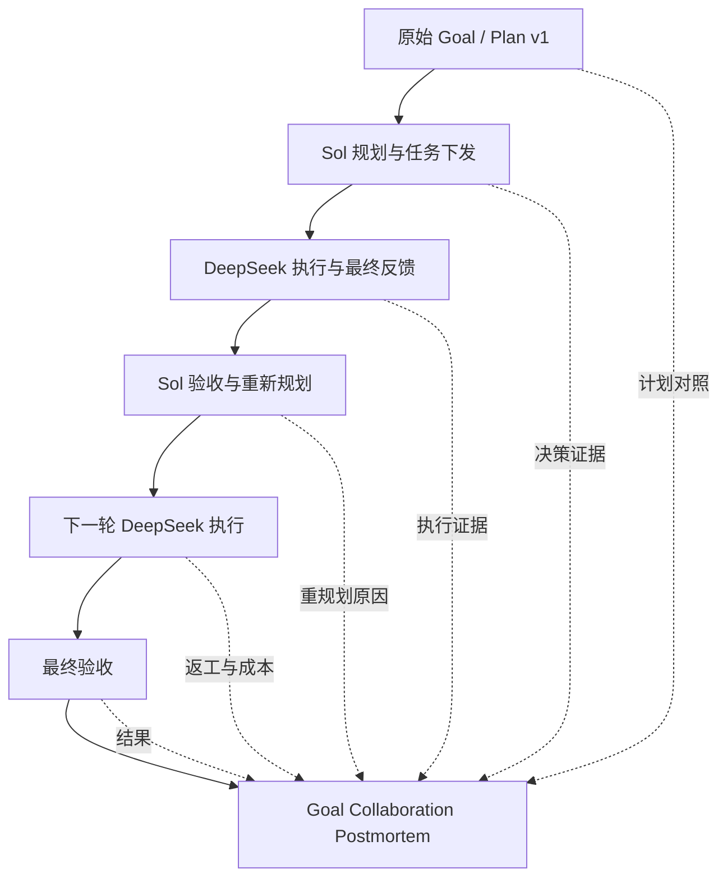

# 四种 Goal 生命周期 Skill 设计讨论（本地化）

归档日期：2026-10-15（America/Los_Angeles）。来源：本轮用户粘贴的外部对话片段，只含一段可见回答，不是完整双方会话。

[原始文本](../sources/2026-10-15-four-skills.original.txt)逐字节保留。以下清除页面图卡残片与 Mermaid CSS；流程图依据导出中的可见标签重建。原文“我核对了仓库”等表述属于历史回答，本次整理未再次联网核验。仓库能力、版本及链接应在实际采用前复查。

供实施查阅的归纳版见 [四种 Skill 设计](../design/FOUR_SKILLS_DESIGN.md)，候选来源见 [Skill 候选](../references/SKILL_CANDIDATES.md)。

---

这套四种 Skill 的设计方向是合理的，而且比把大量 GitHub Skills 全部加载到 Sol 和 DeepSeek 中更适合你的 Windows 多 Agent 开发工作台。

我核对了主要仓库的实际 `SKILL.md` 后，建议保留四种能力，但不要照搬四个现成 Skill。其中两种可以较多借鉴现有实现，另外两种必须围绕你的双 Agent 架构重新设计。

## 一、四种 Skill 的评估结论

| Skill              | 参考项目                       | 匹配度 | 我的建议                    |
| ------------------ | -------------------------- | --- | ----------------------- |
| Prompt Optimizer   | getsentry/prompt-optimizer | 很高  | 复用任务契约和提示词优化方法          |
| Session Postmortem | giannimassi/agent-retro    | 中   | 复用单会话分析方法，重做 Goal 协作链分析 |
| Goal Review        | tomzx/verify-pr            | 高   | 复用验收项到证据的映射方法           |
| Token Audit        | bm629/token-optimization   | 中   | 复用消耗诊断方法，统计与预算控制独立实现    |

有两处值得特别强调。

第一，`agent-retro` 并不是现成的双 Agent 协作复盘器。 它目前明确只支持 Claude Code 的本地 JSONL 记录。因此，你可以复用其错误分析方法，但无法直接拿它完成 Windows Sol → WSL DeepSeek → Windows Sol 的跨会话复盘。

第二，`verify-pr` 并不是一个完全只读的验收 Skill。 它包含构建、运行、录制和文件操作等能力，并依赖 GitHub PR、Git Worktree、Playwright 等环境。你的 Goal Review 应保留其证据核对思想，但把测试执行权限留给受控执行器。

所以，你原有的四种能力不需要推翻，需要调整的是它们在系统中的权限、调用时机和执行成本。

## 二、逐项看，哪些值得复用，哪些需要改造？

### 1. Prompt Optimizer：保留，但做成两种模式

`getsentry/prompt-optimizer` 的优势是先明确任务契约，再处理提示词，而不是单纯优化措辞。它还包含候选 Prompt、评估样例和对照测试。

不过，如果每次创建 Goal 都执行完整优化循环，会带来额外的 Sol 消耗。

因此建议设计：

| 模式             | 何时使用           | 行为                      |
| -------------- | -------------- | ----------------------- |
| Quick Optimize | 日常需求、创建小 Goal  | 一次分析，生成优化 Prompt 和差异    |
| Deep Optimize  | 重大 Goal、反复执行失败 | 多候选 Prompt、代表性用例评估、失败分析 |

另外，OpenAI define-goal 值得借鉴，但它明确只负责目标定义，不负责持久化计划和执行记录。后两者应继续交给你的 Windows 调度器。

建议：Prompt Optimizer 为可选 Skill，不要成为每条 Sol 消息的默认处理步骤。

### 2. Session Postmortem：必须升级为 Goal Collaboration Postmortem

这是我认为需要改造最多、也最有价值的一项。

现有 `agent-retro` 和 Bitwarden retrospecting 都值得参考，尤其是多来源证据收集、Git 变更、错误重试、工具开销和经验总结。

但你的需求更进一步。

它不是简单地评价两个 Agent 各自做得怎么样，而是分析：

<!-- 原导出只有流程节点标签及 CSS；下图依据可见标签重建，用于阅读。 -->


建议 Postmortem 支持三个分析范围：单独 Sol 会话、单独 DeepSeek 会话、完整 Goal 双 Agent 协作链。对于完整 Goal，重点分析计划的合理性、各轮行动的因果关系、无效返工、验收效率以及成本。

这里有一个必须正视的限制：你不希望保存 WSL Codex 的大量中间输出，因此无法事后精确还原未记录的内部错误尝试。

我的建议是保留少量结构化事实，而非原始输出洪流：

`决策 ID → 任务 ID → 运行状态 → 错误类型/摘要 → 测试证据 → Sol 验收 ID → 下一次决策 ID`

这足够评价总体规划与协作逻辑；需要深入分析命令级失败时，再依赖专门保存的脱敏错误证据。未记录的过程统一标记为 `UNKNOWN`。

### 3. Goal Review：拆开“执行验证”和“验收判断”

`verify-pr` 最值得借鉴的是：

每一项验收要求都必须对应可检查的实现和运行证据。

但它自己可以运行测试、录制证据，并围绕 GitHub PR 工作。

你的系统中不应该赋予 Review Skill 这些执行权限。

推荐将其拆成两个组件：

| 组件                        | 职责                                               |
| ------------------------- | ------------------------------------------------ |
| Python Evidence Collector | 收集测试退出码、Git 状态、运行证据和构建结果                         |
| Sol Goal Review Skill     | 对照冻结的 Goal 标准，给出 PASS / FAIL / BLOCKED / UNKNOWN |

最终还必须由 Python 调度器检查验收对象的 Goal 版本、代码快照和状态门禁。Sol 的 `PASS` 不应单独触发 Goal 完成。

对于重大 Goal，我还建议增加一项目标正确性检查：不仅确认实现满足规格，还要检查原来的规格是否真正对应用户要解决的问题。这可以借鉴同一仓库的 validate-pr，但不需要另建一个常驻 Agent。

### 4. Token Audit：必须是分析插件，而不是计量器

`bm629/token-optimization` 的重点是诊断上下文膨胀、工具结果过长、缓存使用和模型选择等问题。它强调优化完成整个任务的总消耗，而不只是单次请求。

因此它适合作为 Token Audit Skill 的知识来源，不适合直接承担实时用量采集。

建议维持已有分工：

- Python 采集每轮 Token 与可获得的费用信息。
- Python 根据 Session / Goal 预算决定绿、黄、红状态及停止条件。
- 前端点击展开每轮、累计 Token 曲线。
- Token Audit Skill 只在用户主动请求或预算异常时进行诊断。

你已经确认的预算规则也应保持：执行预算达到 100% 后，不自动启动下一轮；当前轮次安全收尾，再由 Sol 使用独立复核预算整理结果。

## 三、这四个 Skill 应该如何协作？

我不建议它们自动互相调用，形成又一套 Agent 循环。

应由 Windows 调度器根据明确的任务事件决定调用时机。

| Skill              | 调用时机                  | 是否默认启动  | 能否决定 Goal 状态 |
| ------------------ | --------------------- | ------- | ------------ |
| Prompt Optimizer   | 用户要求优化需求或 Goal Prompt | 否       | 否            |
| Goal Review        | Worker 提交有效阶段结果       | 是，受预算约束 | 提出建议，调度器最终裁定 |
| Session Postmortem | 用户请求复盘、重大失败或手动触发      | 否       | 否            |
| Token Audit        | 用户查看异常原因或手动分析         | 否       | 否            |

它们都应该复用同一套持久化事件与证据数据，而不是每个 Skill 再去扫描、解析、储存一份独立的历史。

在接口层，四个 Skill 统一使用：

```
{
  "schema_version": "1.0",
  "skill_id": "goal-review",
  "goal_id": "goal-001",
  "session_ids": ["sol-001", "deepseek-001"],
  "input_refs": [],
  "findings": [],
  "evidence_refs": [],
  "uncertainties": []
}
```

实际执行时再为各 Skill 扩展专有字段。

这样 Skill 可以随时更换，但前端、数据库和调度器不需要跟着更换。

## 四、我会调整你原来的实施优先级

推荐实施顺序

1. 先建立统一事件与证据协议

   固定 Goal、Plan Version、Session、Decision、Run、Evidence、Token Usage 之间的关系。
2. 实现轻量 Prompt Optimizer 和 Goal Review

   优先让 Sol 能生成可靠任务，并正确验收 WSL DeepSeek 的结果。
3. 实现 Goal Collaboration Postmortem

   在完整行动链上分析任务安排、反馈利用、重规划质量和执行效率。
4. 加入 Token Audit Skill

   使用前面已建立的 Token 数据和协作记录，定位具体的高消耗原因。

## 五、最终建议

四个 Skill 都值得保留，但我会把它们定义为：

| 最终 Skill 名称                     | 最主要的价值                        |
| ------------------------------- | ----------------------------- |
| `prompt-optimizer`              | 让任务描述更准确、可执行                  |
| `goal-review`                   | 让执行结果有证据、可验收                  |
| `goal-collaboration-postmortem` | 让两个 Agent 的规划、执行和重规划过程可解释、可改进 |
| `token-audit`                   | 让高消耗阶段能够被定位和优化                |

其中，Goal Collaboration Postmortem 是最值得自行开发的核心 Skill，因为 GitHub 上的单会话复盘工具尚不能直接覆盖你要求的跨 Agent 规划—执行—反馈因果链。

而且我不建议在这里再引入更多 Skill。你已经有 `codebase-design`、`unslop`、`code-simplifier` 等工程规范能力；这四种则专门负责 Goal 生命周期，两套能力分工清楚。

最合理的下一步是先定稿统一事件协议，并用一个模拟 Goal 完整重放：

Sol 下发任务 → DeepSeek 失败 → Sol 重规划 → DeepSeek 修复 → Sol 验收 → Postmortem 分析 → Token Audit 解释成本。

只要这条模拟链能够被完整记录、显示、审计和恢复，就能证明四种 Skill 的底层数据接口已经真正可用。
