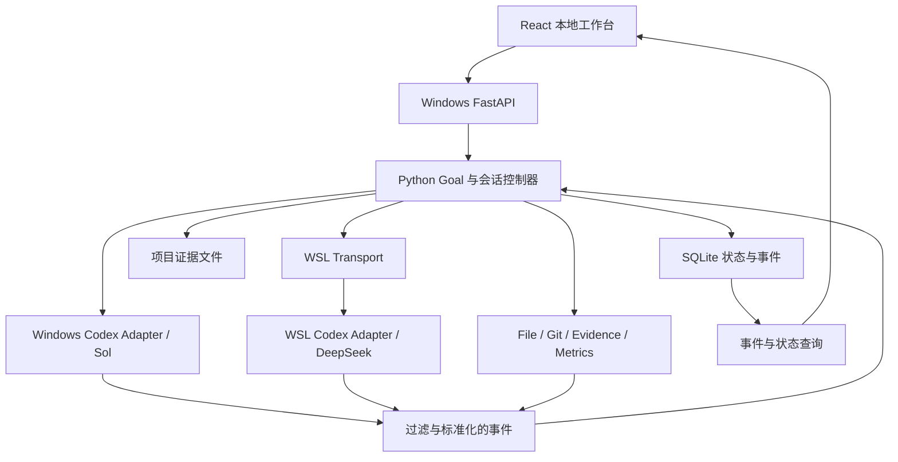
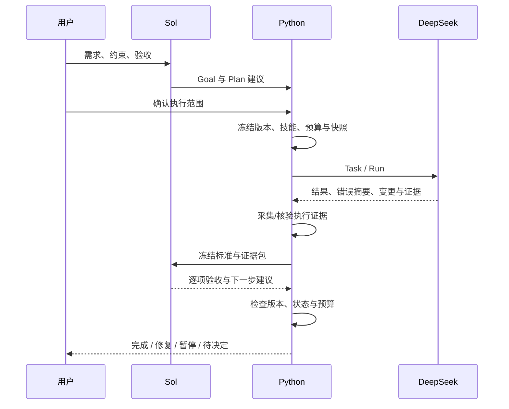

# agentProj 工作台整体设计与审阅稿

版本：v0.2；日期：2026-10-15（America/Los_Angeles）；状态：**本地 Web 交付形态已确认，完整闭环待外部 Agent 实施**。

本文综合既有设计、16 个参考仓库的公开资料与 30 份固定版本文件，给出一套可落地的推荐方案。既有 R01–R17 约束继续保留；本轮提出的技术栈、默认值和分期方式均是待审阅建议。外部文档核验不等于本机兼容性验证。参考依据见 [GitHub 调研](../references/GITHUB_PROJECT_RESEARCH_2026-10-15.md)与[版本清单](../references/github-research-2026-10-15.json)，审阅议题见 [DESIGN_REVIEW.md](DESIGN_REVIEW.md)。

用户最新决定：采用本地网页先打通完整闭环，并要求准备执行计划及提示词交由另一个 Agent 实施。具体范围、阶段、默认技术选择和完成标准以 [执行计划](IMPLEMENTATION_PLAN.md)为准，执行入口为 [Agent 交接提示词](../CODEX_HANDOFF.md)。此决定没有设定真实调用额度，也没有宣称其余建议全部已被逐项确认。

## 1. 推荐方案概览

构建一个以工作目录为单位的本地 AI 开发工作台：Windows Sol 与用户讨论和规划，WSL Codex / DeepSeek 执行实现，Sol 依据证据验收；Windows Python 统一控制这条闭环，并保存可恢复的状态、版本、证据和用量。

推荐采用 React + TypeScript 界面、FastAPI 本地后端、SQLite 状态库和项目内文件证据。第一版通过浏览器访问本机服务；闭环稳定后按需要套 pywebview 桌面窗口。两个 Agent 优先通过官方 Codex App Server 接入，普通工具通过少量明确的 Python/CLI/MCP 接口扩展。

产品的关键能力是：目标和验收标准可追溯，执行反馈能形成下一次有依据的决策，达到预算后不能自动继续，退出或崩溃后能解释发生了什么。界面、Skill 和 Ops 共同使用这套事实记录。

| 设计问题 | 推荐选择 | 仍需审阅或验证 |
| --- | --- | --- |
| 调度所有权 | Windows Python 唯一拥有 Goal 循环、状态、预算和恢复 | 不引入第三套自主调度运行时 |
| 用户界面 | **本地 Web 已确认**；React/TypeScript 为实施默认 | 桌面壳后续另行决定 |
| Agent 接入 | Windows / WSL Codex App Server，分开配置 | 实际版本、认证、模型能力、暂停和续接 |
| 持久化 | 本地 SQLite 为状态事实源，大文件为证据 | 保留期、备份频率及 WSL 原生项目的存储位置 |
| 执行并发 | 一个工作目录同时一个写入 Worker | 多会话讨论可独立；并行写入后置 |
| 默认源码位置 | 当前 Windows 工作目录，WSL 访问同一份源码 | 大型 Linux 项目另测 WSL ext4 的收益 |
| Skill / Wiki | 少量、按范围选择，记录来源和版本 | 严格 Skill 隔离需原型验证 |
| 预算 | 到 100% 禁止下一执行轮，保留当前轮收尾策略 | 复核预留是否启用及其额度 |

## 2. 既有要求与本轮设计的关系

| 已保留要求 | 在本方案中的落实 |
| --- | --- |
| R01：Sol 规划验收、DeepSeek 执行、Python 调度 | Agent Adapter 不拥有 Goal 自动循环，状态转换只由后端提交 |
| R02–R03：工作目录/新会话隔离，切强度保留历史 | Workspace、Session、原生 Thread 分开建模；新建和续接是不同操作 |
| R04–R06：Wiki 授权、相关提示、Markdown 导入 | 元数据和正文的访问范围分别记录，导入指定目标作用域 |
| R07：输出可观察、保留事实、不存隐藏推理 | 展示流、持久事件、验收输入三条路径分别过滤 |
| R08–R09：Skill 按需、优化展示差异 | Registry/会话/单轮选择，保留原文和 Prompt 修订 |
| R10–R11：全链复盘、范围与分析者可选 | 显式因果边连接 Plan、Decision、Run、Result、Review |
| R12–R15：用量、Python 门禁、100% 停止与明确恢复 | 累计账本、未结算预留、执行锁和恢复记录 |
| R16：参考设计、避免过度工程 | 少量进程与模块，初期无服务集群、向量库或插件商店 |
| R17：本地记忆与 Wiki 引导 | 延续现有 MEMORY、WIKI、专题设计和原文来源结构 |

原始表述与未定项仍以 [决策文件](DECISIONS_AND_OPEN_QUESTIONS.md)为准。本轮调研和讨论请求记录为新增 R18，不将下面的推荐自动升级成用户已确认的要求。

## 3. 从参考项目中采用的设计

工作台交互参考 [CodexFlow](https://github.com/lulu-sk/CodexFlow)，结构化 Provider 接入参考 [T3 Code 的 Codex Adapter](https://github.com/pingdotgg/t3code/blob/26fffe5aee22ea9bdd39c5b4c400f643c560b4a0/apps/server/src/orchestration-v2/Adapters/CodexAdapterV2.ts)，运行时拥有状态和恢复的分工参考 [AGX 架构](https://github.com/nashory/agx/blob/c864f80bc34cce1f3b2779f43ac57bde234576cc/docs/ARCHITECTURE.md)。本方案据此保留清晰的 UI、控制器、Agent 接入边界，不移植其整套运行时。

资料组织参考 [ops-workflow](https://github.com/OdinMB/ops-workflow)，观测页面参考 [Hermes Operations](https://github.com/c-pompa/operations-hermes-desktop-plugin)，调用关系的数据表达参考 [Langfuse Observation](https://github.com/langfuse/langfuse/blob/0690d7d268c4cfa7bd7dfa3b1d7976bb37a9fd25/packages/shared/src/domain/observations.ts)。本项目仍自行定义 Goal 版本、验收和预算规则。

第三方 Skill 只借鉴工作方法；文件工具优化先保留为实验。项目不以 Fork 某个工作台为默认开发路线。具体来源、读取范围、许可和不采用的部分见调研文档。

## 4. 用户界面与主要操作

界面围绕工作目录与当前 Goal 展开，不要求用户理解后端协议或进程细节。

**2026-10-15 用户布局补充（待详细设计）**：用户提供单页 PPT 截图，以左侧项目/会话导航和主区两个 Agent 的对话记录为中心，包含对话导入、Agent 选择及 Dashboard 入口。明确要求 Dashboard 展示该会话的用量/分析，交互借鉴 Langfuse；每个会话需要执行时间线和异常恢复。图中 `db` 与左栏入口的准确含义尚未确定，不解释成已确认的数据库管理功能。

需要先明确 UI“协作会话”与后端单 Agent `Session`、Goal 的映射；现实现为每个 Goal 关联 Sol/Worker 两个 Session。业务容器、两个原生历史与统计范围不能因前端合并展示而混同。Dashboard 范围、时间线跳转及恢复动作均待界面与接口共同细化；该需求不等于已批准部署或上传数据到外部 Langfuse 服务。

| 页面 | 用户能做什么 | 关键显示 |
| --- | --- | --- |
| 工作目录 | 添加/切换目录，检查环境，查看已有会话 | Windows/WSL 路径、可用环境、当前写入任务 |
| 会话 | 新建空白 Sol/Worker 会话，继续历史，调整模型/强度 | 历史、流式输出、工具卡片、等待/运行/暂停状态 |
| Goal | 创建目标、查看计划、执行、暂停、恢复、验收 | 原始需求、冻结版本、验收项、下一步与预算 |
| 过程与证据 | 按轮次查看交接和结果 | 双角色泳道、测试、Git Diff、错误和证据来源 |
| 用量 | 查看会话/Goal 曲线和异常 | 累计消耗、估算/真实/未知、预留和停止原因 |
| Skills | 导入/选择版本、配置 Profile 和单轮使用 | 已安装、允许、启用、已提供、观察到调用分别显示 |
| Wiki | 搜索设计资料、导入 Markdown、选择要提供的内容 | 标题、摘要、标签、来源、当前允许读取的范围 |
| 工具与扩展 | 配置可用文件/Git/Trace 能力 | 项目允许、会话开启、本轮授权和实际可用状态 |

主布局建议为左侧工作目录/会话列表，中间讨论与执行内容，右侧 Goal/计划/证据面板，底部状态与预算。双 Agent 可并排，也可切换查看；长命令输出折叠为卡片，需要时展开。

“新会话”“继续”“导入资料”分别操作。勾选 Skill 或修改 Profile 只保存配置，不启动模型。达到预算后，运行按钮显示具体阻碍；用户恢复时显示调整后的额度或授权来源。

## 5. 总体架构



所有启动、重试、恢复与外部操作都经控制器准入。UI 不直接启动 CLI；Skill 不改预算；Ops 页面不直接开下一轮。Agent 内部为完成一个已批准任务运行的工具循环，与 Python 负责的 Goal 跨轮循环分开计量和控制。

初期控制器是一个 Python 应用内的模块，不拆成调度服务、事件总线和多个微服务。Agent、必要的 WSL 传输程序及可选桌面壳可以是子进程，但它们不成为第二个状态所有者。

## 6. 技术栈与桌面化选择

| 层 | 推荐 | 选择理由 |
| --- | --- | --- |
| 前端 | React、TypeScript、Vite | 方便实现会话、状态和证据视图，已有参考项目交互可借鉴 |
| 后端 | Python、FastAPI、Uvicorn、Pydantic | 延续既定 Python 调度，接口和结构化消息保持简单 |
| 前后端通信 | HTTP 命令 + SSE 事件 | 操作与输出分离，支持断线后按游标补取 |
| 数据 | SQLite + 明确的 SQL 迁移 + 文件证据 | 本地单写入事实源，避免数据库与 JSON 各自更新 |
| 基础工具 | subprocess、ripgrep、Git CLI | 先满足现有需求，测到瓶颈再替换 |
| 桌面窗口 | 后续可选 pywebview | 保留 Python 服务，减少另建 Electron 主进程的需要 |

[FastAPI 流式响应](https://fastapi.tiangolo.com/advanced/custom-response/)可作为 SSE 实现基础；SSE 的事件 ID、恢复和认证仍由本项目定义。[pywebview 架构](https://github.com/r0x0r/pywebview/blob/3a12be9a8dfc79b8ec52ed1b346852212ca56490/docs/guide/architecture.md)支持连接本地服务，但 Windows 桌面包需实际验证 WebView2 和打包效果。

开发阶段可以用 Vite；交付时由本地后端提供构建后的静态资源，不要求终端用户运行前端开发服务器。Electron 是桌面化的可选替代，不与 pywebview 同时建设两套壳。

## 7. Workspace、路径和源码归属

Workspace 保存稳定 ID、用户选择的原始路径、规范化路径、Windows/WSL 路径映射、WSL 发行版、文件系统归属和授权范围。路径属于哪一侧必须明确，不依靠字符串替换盘符处理 UNC、空格或中文。

第一版针对当前 `C:\Users\Administrator\Desktop\tool\agentProj` 这类 Windows 本地工作目录，Worker 通过已验证的 WSL 路径访问同一份源码。使用系统路径转换能力，验证转换后的目标实际存在且指向期望项目；禁止自动建立“Windows 一份、WSL 一份”的隐式双向同步。

[微软的跨文件系统说明](https://learn.microsoft.com/en-us/windows/wsl/filesystems)提示应根据运行工具的位置选择文件系统。本方案的同一份 Windows 源码是降低第一版复杂度的推荐；大型 Linux 构建若明显变慢，再显式选择 WSL ext4 工作副本，并记录迁移与访问方式。

同一工作目录同时只有一个可写 Worker，Sol 规划/审阅默认只读代码。若未来需要并行写入，给每个执行分配独立 Git Worktree 和代码快照，增加明确的集成验收步骤。讨论并发不等于源码写入并发。

## 8. Session 与原生 Thread

Session 是本产品的会话；Thread 是 Codex 保存的原生对话；Run 是一次由控制器发起的工作；Turn 是原生一次交互。它们使用不同 ID，并保存显式映射。

新建会话调用创建新 Thread 的流程，默认不注入其他会话历史。继续会话绑定同一原生 Thread。导入 Markdown 记录来源、目标 Session/Goal 和哈希，作为显式资料，不伪装成原生历史。基础工程规则及用户主动选择的项目资料可以存在于新会话中。

推理强度变更在后续 Turn 生效；保存变更前后配置与原生 Thread，不能用“切换成功”掩盖新建空白会话。模型/提供商变化只有在后端确认支持同 Thread 时才续接；否则明确创建迁移会话并记录关联。

[官方 App Server](https://learn.chatgpt.com/docs/app-server)提供 Thread/Turn 生命周期和配置接口，适合实现此映射。实际支持的模型与推理档位通过运行时能力查询确定，不把 UI 固定列表当真实可用能力。

## 9. Windows Sol 与 WSL DeepSeek 的接入

两个 Adapter 共用一套精简产品接口：启动或续接会话、提交 Turn、接收事件、中断、查询状态、关闭。协议方法映射集中在 Adapter 中，不散落在前端或 Skill 中。

Windows 端启动原生 Codex App Server；WSL 端由 Windows Python 通过 `wsl.exe` 参数列表启动指定发行版内的 Codex App Server，并进行标准输入输出转发。只在需要解决子进程归属、取消和清理时增加一个小型 WSL 辅助程序；它不规划任务、不改 Goal、不自行续轮。

OpenAI 当前配置要求自定义 Provider 使用 [Responses 协议](https://learn.chatgpt.com/docs/config-file/config-reference)。[DeepSeek 官方 Codex 接入说明](https://api-docs.deepseek.com/quick_start/agent_integrations/codex/)已给出相应 Provider 与模型目录配置，因此推荐保留原执行路线，并先做兼容性实验，不预先增加协议代理。

Provider、模型 ID、认证来源、运行环境和角色分开保存。Sol 使用用户实际可用的模型；DeepSeek 使用实际账户/端点支持的模型。配置从运行时查询和已核验文件生成，不写死某个未来模型或价格。

两个环境使用独立配置与原生会话目录，不把 Windows 的配置目录盲目传进 WSL。凭据通过运行时原生认证或受控环境注入，不写进项目 JSON、Wiki、事件或导出的任务说明。本轮不会改动现有登录或全局 Codex 配置。

## 10. Goal 生命周期与自动化边界

推荐保留少量业务状态：`DRAFT → READY → ACTIVE → COMPLETED`，并允许从活动过程进入 `PAUSED / BLOCKED / CANCELLED`。执行、等待验收、重规划等作为阶段字段，不为每个组合创建新的顶层状态。预算门禁独立为 `OPEN / CLOSED`。

Run 使用 `QUEUED / STARTING / RUNNING / STOP_REQUESTED / SUCCEEDED / FAILED / CANCELLED / INTERRUPTED / UNKNOWN`。Run 成功只表示该次工作产生有效结果，不表示 Goal 通过。

推荐交互：用户确认 Goal、边界和总体计划后，控制器在既定额度/权限内自动安排执行和验收；用户也可选择每轮手动。修复策略可由 Sol 提议，改变用户目标、验收标准或扩大授权范围时停止自动推进并交由用户决定。



Python 接受的下一步是明确枚举，如继续、重试、重规划、建议完成、暂停或请求用户决定。普通自然语言不能直接成为执行命令。

## 11. 一次任务的冻结契约

每个 Run 固定以下输入，运行中不热替换：

| 类别 | 最少内容 |
| --- | --- |
| 身份 | Workspace、Goal、Session、Task、Run、发起 Decision |
| 版本 | Goal、验收标准、Plan、Prompt、Skill 内容版本 |
| 工作副本 | 工作目录、起始代码快照、允许修改范围 |
| 执行目标 | 本轮任务、非目标、依赖、输入资料引用 |
| 验收 | 标准 ID、需要的运行证据、结果格式 |
| 准入 | 权限快照、执行用途、预算策略与收尾方式 |

Worker 回传完成/失败/暂停事实、结果摘要、实际修改、测试、错误类别和证据引用。控制器检查引用存在、作用域正确且属于本 Run。格式错误最多进行有界的格式修复；不得因修复输出而无限重跑实现。

所有协议建议统一使用字符串 `schema_version: "1.0"` 作为新实现起点，最终冻结前建立契约样例。旧示例保留数字版本 `1` 并标为历史草案，不能直接声称与新协议兼容。完整字段在 [数据约定](DATA_CONTRACTS.md)维护。

## 12. 证据采集与 Goal Review

Evidence Collector 是普通 Python 组件，负责在已授权范围内记录或执行必要验证：命令、工作目录、退出码、耗时、测试报告、构建产物、Git 状态和代码快照。Worker 的自然语言自述只能作为候选信息，不能单独构成通过证据。

Review 对每个 criterion 输出 `PASS / FAIL / BLOCKED / UNKNOWN`、证据 ID 和解释。受已知环境阻碍无法验证用 BLOCKED；缺少证据用 UNKNOWN。测试全绿不能替代没有覆盖的用户目标。

自动完成前，Python 至少确认：验收标准版本仍有效；全部必需项有足够证据并通过；审阅的代码快照与目标交付一致；不存在未解决运行或阻碍；当前审阅属于仍有效的 Run/Decision。若期间用户或其他工具修改源码，旧 Review 不能直接完成新快照。

默认允许用户直接编辑工作目录；检测到执行中修改时记录快照变化并暂停自动验收，必要时重新验证。若任务要求冻结环境，则使用显式工作副本，而不是仅靠界面禁用编辑假装源码不会变化。

重大 Goal 可检查规格是否真正回应用户问题。发现目标不合适时提出修订，不覆盖旧标准追认结果。验收方法参考 verify-pr 的证据映射，但本产品的 Review 不直接获得安装、构建、外发评论或发布权限。

## 13. 数据与事件的单一事实源

推荐在 Windows Python 所在的本机本地磁盘保存数据库。初期当前 Windows 项目内使用 `.agentproj/state.sqlite`，WSL 不直接读写此数据库，只提交结构化事件与结果。SQLite WAL 要求同主机共享内存，不能将跨 Windows/WSL 或 UNC 共享写当作已支持能力。[SQLite WAL](https://sqlite.org/wal.html)

| 数据组 | 主要对象 |
| --- | --- |
| 范围与会话 | Workspace、Session、RuntimeBinding、Authorization |
| 目标与版本 | Goal、GoalRevision、AcceptanceRevision、PlanRevision |
| 协作链 | Decision、Task、Run、Result、Review、CriterionResult |
| 证据与配置 | Evidence、CodeSnapshot、SkillRevision、SkillUsage、ProfileSnapshot |
| 计量与审计 | UsageEvent、BudgetReservation、Event、CommandReceipt |
| 资料 | WikiEntry、ImportedSource |

名称是逻辑对象，不要求一开始全部拆成独立表。能清楚表达一对多关系和不可变版本的内容才单独建表；小型固定配置可存结构化字段。

每次状态修改与其持久事件在同一事务提交。当前状态是追加事件的投影，但 MVP 不建设通用事件溯源框架。事件至少携带项目内顺序号、类型、相关 ID、因果引用、schema 版本与必要内容。

命令使用幂等键和期望 revision，防止重复点击、重连和迟到消息再次启动 Run。一个事务完成预算预留、写入任务和占用执行槽；进程启动失败要有明确的失败记录与预留处理。

## 14. 输出流、持久事件与验收输入

| 路径 | 处理方式 |
| --- | --- |
| 前端实时展示 | 公开自然语言输出、工具状态、命令增量；大内容折叠，临时缓冲有上限 |
| 长期事件 | 指令、可见决定、版本、执行状态、必要结果、计量与证据引用 |
| 本地证据 | 测试/构建日志、错误片段、Diff 和报告，可按范围补读 |
| Sol 验收输入 | 冻结任务、结构化结果、必要证据及缺失项，不复制全部 WSL 过程 |

Adapter 按允许的事件/字段建立产品事件，先过滤再写入日志、数据库和 UI；不采集或展示原始 reasoning 字段，也不为复盘请求隐藏推理。原生运行时自己的存储需另外审查，不能仅凭产品不落盘就宣称第三方运行时从不保存这些内容。

普通 Agent 中间文字可实时展示，默认不全量沉淀为项目记忆。最终/暂停报告保留；重要命令输出按证据策略保存。截断记录原始范围、文件位置和补取入口，不把截断后的空白当成成功。

SSE 对已持久事件使用稳定游标，重连后从游标补取；高频文字增量合并传输，不逐字做数据库事务。临时增量丢失时重新获取已完成内容与最新状态，不能承诺所有未落盘字节均能重放。UI 断开不直接取消后台 Run。

## 15. Token、费用和预算

必须分开显示：上下文占用、本轮消耗、整个会话累计、当前 Goal 累计、费用估算与套餐限额。上下文窗口大小不是任务预算，最近一次响应也不等于一个包含多次模型请求的 Turn 总量。

用量适配参考 [T3 的聚合代码](https://github.com/pingdotgg/t3code/blob/26fffe5aee22ea9bdd39c5b4c400f643c560b4a0/apps/server/src/provider/CodexTurnTokenUsage.ts)：结合累计快照、最近请求和归属 Turn，处理恢复、重置、重复和迟到。实际语义以固定版本的协议和实验为准；遇到不明重置记录未知或待结算，不能凭空补成零。

缓存输入可能已包含在输入总量中，推理 Token 可能是输出的子集；每个 Provider 保存口径，不能把细分项再次相加。估算保留估算方法，费用附价格日期、币种和来源。无法获取的套餐剩余量显示未知，不从 API Token 推算成精确套餐百分比。

启动前的确定性检查为：Goal 状态允许、权限有效、会话预算允许、Goal 预算允许、未结算预留已计入。执行预算到 100% 后，所有新的执行 Run 和自动重试入口关闭；当前 Run 按冻结策略安全收尾或中断。

复核预留若启用，应从用户总预算内划分，只用于终止整理和必要复核；不能启动新的实现任务。总额或复核额度不足时由 Python 输出事实记录。用户主动恢复必须记录批准或预算变化，重启不能自动清除停止锁。

控制器能保证“达到阈值后不启动下一 Run”，但 Codex 内部一次 Turn 的多次推理、自动重试及延迟计量可能产生当前轮超额。第一版不承诺绝对 Token 硬上限；如确需逐请求硬限制，再研究 Provider 限制或经过验证的网关，而不是为普通用量监控先增加代理。

70%/90% 只是建议预警阈值，金额、Token 限额和预留比例都未获本轮用户批准。详细规则见 [用量与预算](BUDGET_AND_USAGE.md)。

## 16. Skill Registry 与运行时隔离

统一 Registry 保存来源仓库、路径、固定 commit、内容哈希、许可证、依赖和审核状态；Registry 本身不放在所有 Agent 默认扫描的位置。项目允许列表决定可以提供哪些 Skill，会话快照决定后续可用集合，单轮选择只在其范围内生效。

推荐每个逻辑会话使用独立的运行时配置与用户 Skill 根目录，只投放经过选择的版本。项目/父目录原有 Skill 仍可能被运行时发现；原型必须验证实际可见集合，必要时在独立配置中禁用未允许条目。只复制所选文件不自动等于完成隔离。

[官方 skills 接口](https://learn.chatgpt.com/docs/app-server)区分按 cwd 的发现、额外根目录和进程级设置。相同 cwd 的两个会话不能仅靠列表筛选实现权限隔离；对进程级设置不使用共享进程热改，避免影响另一个会话。验证失败就报告该能力尚不可用，不以提示词冒充后端保证。

Skill 版本在 Run 冻结。Profile 是初始化快照，更新 Profile 不静默修改已有会话。关闭 Skill 只撤销后续提供，不擦除已在历史中的内容；需要严格去除历史影响时，显式新建上下文并保留必要来源关联。

初批工程 Skill 保持小集合：设计、最小编码规则、按需 Diff 简化。四种生命周期 Skill 使用同一 Registry 机制，但调用由调度器按阶段和预算决定。详细见 [Skill 管理](SKILL_MANAGEMENT.md)。

## 17. 四种 Goal 工作流

| 工作流 | 建议实现 | 约束 |
| --- | --- | --- |
| prompt-optimizer | Quick 一次整理契约和差异；Deep 在重大/反复失败 Goal 做候选与用例评估 | 保留原目标，不默认每条消息执行 |
| goal-review | 对照冻结标准、快照与证据输出逐项结果 | 只提建议，执行与最终状态由 Python 控制 |
| goal-collaboration-postmortem | 分析计划、执行、反馈、重规划、返工和成本的因果链 | 支持单会话或完整 Goal，缺失写 UNKNOWN |
| token-audit | 基于已有计量诊断高消耗原因与改进假设 | 不计量、不放行、不自动启动修复 |

它们是按需加载到现有 Agent 的工作流，不是四个常驻 Agent；不互相自动调用。默认可由所选 Sol 会话承担分析，用户也可选择另一个已有、已授权的分析者。分析者与分析范围分开建模，选择双模型分析也要计入预算。

复盘保留原计划对照、每次指令与反馈、依据的结果/证据、下一决定及计划影响。指标使用返工比例、首次验收通过、重复错误和完成里程碑的成本，并注明分母、任务差异及缺失数据。可见的必要探索不自动算作浪费。

具体输入输出、来源和共用封装在 [四种 Skill 设计](FOUR_SKILLS_DESIGN.md)。这些工作流不能通过各自扫描一遍全部原始历史来建立第二套记忆。

## 18. Wiki、会话记忆与资料导入

保留四个层次：当前会话历史、当前 Goal 资料、工作目录 Wiki、需要额外授权的全局资料。模型按标题、摘要、标签和来源定位，再读取必要正文；第一版不要求向量数据库或自动知识图谱。

产品的设计文件继续沿用 `AGENTS.md → MEMORY.md → WIKI.md → 专题`。运行时每次上下文组装记录 `context_manifest`：提供了什么、来源/版本、作用域、用途，以及被排除或缺失的内容。索引更新不自动把整篇对话灌入所有会话。

导入 Markdown 时指定工作目录及 Session/Goal，保存文件哈希、导入日期与来源说明。发现相同哈希可共用一份来源文件，但每次导入授权和目标关联分别记录；不能因内容相同就把两个会话的历史合并。

跨目录“发现相关资料时提示”只依据已经获准可见的元数据；未获授权不能先读正文来决定是否相关。用户选中后再授权相应正文范围。外部网页、导入对话和仓库文件作为资料，不自动获得修改调度或权限的能力。

Wiki 支持确定性的链接/孤立条目检查，摘要更新可手工或按需由模型完成；不为每次文件变化都自动调用模型。来源原文与当前采纳设计分开保存。

## 19. Ops 与观测界面

第一版内置 File、Git、Workflow、Evidence、Trace/Metrics 的实际必要操作。接口围绕搜索、读取、Diff、状态查询和证据采集设计，不先建设通用插件商店或把所有命令抽象一遍。

| 视图 | 展示内容 | 操作入口 |
| --- | --- | --- |
| Handoffs | Sol 下发、Worker 返回、Sol 反馈的双角色泳道 | 跳转任务、结果、证据和版本 |
| Trace | Decision/Run/Review 与工具活动的时间线 | 展开对应事实，标记未知过程 |
| Flow | 角色、会话、模型/Provider 的请求关系 | 按 Goal、Run 和来源筛选 |
| Activity | 错误、状态、等待、预算和配置变化 | 读取上下文；需要执行时发给控制器 |
| Metrics | 每轮/累计 Token、耗时、错误率和验收进展 | 手动触发分析，记录分析成本 |

Operations 提供了有价值的页面参考，但其运行时依赖和任务启动行为不直接接入本项目。常规看板由程序聚合；自动文字 Activity Summary 默认关闭。用户请求解释时才调用所选模型，并受相同预算门禁。

文件工具先用现有程序，再对固定版本 FastCtx 做完整性、调用次数、模型 Token、端到端耗时与维护成本的对照。远程 SSH 和 CI 等到真实需求出现再增加，仍使用同一授权与事件关系。详见 [Ops 设计](OPS_CAPABILITY_DESIGN.md)。

## 20. 权限、作用域与实际保证

授权以工作目录、会话和单个 Goal 的临时范围表达，执行时核验；前端选择只保存配置。Sol 的规划/Review 默认使用必要读取能力，Worker 在已批准的代码与命令范围工作；用户可明确扩展范围。

关闭某个 Ops Adapter 只关闭该入口。若模型还拥有同等能力的 Shell，就不能宣称整个环境都已隔离。需要限制的操作必须同时覆盖所有可执行入口，能依赖原生沙箱的使用原生沙箱，无法验证的限制显式标注。

本地服务默认仅监听回环地址，采用每次启动的本地认证会话并校验来源；不能因为是 localhost 就允许任意网页发启动命令。桌面壳只暴露必要文件选择/窗口能力，不创建另一条绕过调度的执行桥。

凭据、原始推理及与任务无关的个人资料不进入普通项目事件与导出报告。第三方代码和 Skill 在实际采用时检查具体版本与附带声明，不把下载视为脚本执行许可。

## 21. 暂停、取消、崩溃与恢复

| 情况 | 预期处理 |
| --- | --- |
| 暂停 Goal | 立即关闭下一轮准入；当前 Run 按既定策略收尾或中断 |
| 取消当前 Run | 先请求原生 Turn 中断；超时后只清理本产品拥有的进程树/组 |
| UI 关闭或重连 | 不影响其他观察者；后台状态可重新查询，退出应用的行为单独定义 |
| Python 重启 | 先恢复数据库与执行锁，再核实原生线程和进程；不自动重发未确认任务 |
| WSL 通道中断 | 检查客体进程是否仍活着，不能把 wsl.exe 退出等同于 Worker 已停止 |
| 结果或用量迟到 | 按 Run/Turn/运行时实例归属，更新对应事实；不得推动过期的下一决策 |
| 测试超时或缺少结果 | 保存阻碍/未知与部分证据，不推断通过 |
| 磁盘满或写入失败 | 阻止新轮次，保留可报告事实；不能继续运行却声称审计完整 |

每个活动执行记录启动标识、原生 PID/开始时间或等效身份、持有者和运行时实例。恢复时结合协议和进程身份确认，避免 PID 复用。第一版可用简单单实例锁加数据库 revision，不为此引入分布式锁服务。

进程取消必须限于本产品拥有的运行；不使用终止整个 WSL 发行版的方式代替清理。无法确认是否已停时标 UNKNOWN 并阻止冲突写入，给用户可核实的事实。

## 22. API 与前后端契约

接口数量围绕用户操作保持小而明确：

| 接口组 | 行为 |
| --- | --- |
| `/workspaces` | 注册、切换、检查路径/环境；不隐式扫描全盘 |
| `/sessions` | 新建、继续、修改后续配置、显式导入 |
| `/goals` | 草稿、计划版本、确认执行、暂停、恢复、取消 |
| `/runs` | 查询、请求中断、查看结果与证据 |
| `/skills` | 查询 Registry、项目允许与会话/单轮配置 |
| `/wiki` | 索引查询、范围内正文、导入与授权 |
| `/usage`、`/trace` | 查询已经记录的聚合与协作链 |
| `/events` | SSE 持久游标与临时展示流 |

修改请求携带幂等键及期望 revision。命令回执返回接受、拒绝或已有执行，以及可读原因；预算/权限不满足不是模糊的服务器失败。查询接口不触发模型，分析操作使用独立、可计量的命令。

前端持有服务端状态的显示副本。乐观更新只用于可撤回的界面反馈；Run 是否启动、Goal 是否完成一律以服务端事件为准。

## 23. 运行数据与工程目录

推荐运行数据布局如下，当前仍未创建实际运行状态：

```text
<工作目录>/
  docs/                         当前项目的设计和来源
  .agentproj/
    state.sqlite                Windows Python 单写入
    goals/<goal-id>/
      plans/                    不可变版本导出
      runs/<run-id>/
        task.json               冻结任务导出
        result.json             结构化结果导出
        evidence/               必要测试、错误、Diff 和快照
      reviews/                  验收与复盘报告
    wiki/                       工作目录索引导出
    imports/                    来源去重副本与导入说明
```

数据库是状态事实源，文件 JSON 是带 revision/hash 的导出或不可变证据，不允许两端分别修改后“自动合并”。导出文本供模型按需读取，生成时记录所基于的版本。

Registry 和会话运行时配置放用户本地应用目录，按 Workspace/Session 隔离；WSL 原生配置放该发行版内合适的位置。记录明确映射，避免运行时自动扫描整个 Registry。

未来若项目本体位于 WSL ext4 或其他不适于 Windows SQLite 的位置，数据库迁到 Windows 本地应用数据目录并保留唯一定位记录，项目内只保留导出与证据引用；不增加第二个可写数据库。这项扩展在相关工作目录进入支持范围时再实现。

代码建议分为 `ui/` 与 `backend/`，后端包含会话、Goal、事件、预算、证据、Skill/Wiki 和 Windows/WSL Adapter。模块以实际职责拆分，先使用明确函数与少量接口，不预建通用 Provider 框架。

## 24. 实施顺序与验收

| 阶段 | 交付内容 | 通过条件 |
| --- | --- | --- |
| P0 兼容性原型 | 固定 CLI/协议版本，Windows/WSL 连接、Thread、DeepSeek、用量、Skill 作用域、取消 | 用真实小任务和明确证据回答可用/不可用/未知；不读取凭据内容作报告 |
| P1 事件与模拟链 | 最少对象、状态事务、预算预留、证据关系与模拟重放 | 完整记录失败→重规划→修复→审阅，重复/迟到/重启不产生额外执行 |
| P2 首个真实闭环 | 单工作目录、两个角色、一次真实执行与基于证据的审阅 | 目标和快照可追溯，失败能停，达到预算不自动下一轮 |
| P3 日常工作台 | 会话、Goal、证据、预算曲线、手工 Markdown 导入、本地 Wiki | 新会话隔离、切强度保留历史、界面重连与授权范围有效 |
| P4 Skill V0.1/0.2 | Registry、快照、Quick Optimizer、Goal Review、单轮选择 | 只提供允许版本、配置不冒充调用、Review 不改状态 |
| P5 全链复盘与审计 | Postmortem、Token Audit、Trace/Handoffs、升级/回滚记录 | 问题和成本可定位到证据，缺失不归责，分析也受预算约束 |
| P6 可选扩展 | pywebview 打包、Worktree 并发、FastCtx 对照、SSH/CI | 每项由实际需求与前一阶段证据触发，不改变原调度所有权 |

P0 调用真实模型需要配置有效账户并使用明确的小额测试额度；本轮仅交付方案，没有替用户运行或购买这些测试。模拟链只证明接口和状态设计，不替代真实运行验收。细分实施安排继续维护在 [实施计划](IMPLEMENTATION_PLAN.md)。

验证集中于真实边界：版本/快照错配、预算停止和恢复、重复命令、迟到计量、运行时中断、会话/Skill 作用域和缺失证据。不为低影响文档或简单显示堆砌测试，也不以大量单元测试代替完整用户场景。

## 25. 第一版支持范围与扩展条件

第一版支持当前本地 Windows 工作目录、一个写入 Worker、多个独立讨论会话、结构化 Goal 闭环和项目内 Wiki。桌面包、远程服务、多写入并发和高级文件工具按 P6 逐项扩展。

不在第一版建设的内容有：自动全网 Skill 商店、默认跨项目语义检索、任意模型/任意协议通用路由、无人监管的发布循环、独立观测数据库集群。这些只有在实际需求和维护能力足够时再提出设计。

运行时/协议升级先在兼容性原型回归，再切换新启动的会话或明确迁移；运行中的冻结配置不热替换。备份 SQLite 时使用一致性备份方式并包含关联证据，不直接复制一个正在写的主数据库文件后宣称完整。

## 26. 优先审阅的选择

第一版采用本地 Web 已获用户确认。总体计划确认后的自动化边界、单写入 Worker、源码位置和复核预留按执行计划的保守默认推进原型；不可推断的目标变更、真实预算与凭据由执行 Agent 按实际缺口集中说明。

技术栈、独立运行时、数据目录、首次工程 Skill 和最终人工验收要求随后逐项审阅。全部议题及推荐/替代方向见 [审阅清单](DESIGN_REVIEW.md)。确认一项就更新该项决定和专题，不把整份待审阅稿一次性视为已获批准。
